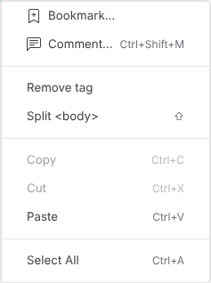

# User manual screenshots

## Images missing in the in-app manual

The user manual pages reference their images relative to the markdown file (`../images/x.png`), which works on GitHub. The in-app manual (`app/src/plugins/info.js`) inserts the rendered HTML into the app page and only rewrote `src="images/…"` and `src="./images/…"`, which no page uses. The browser therefore resolved `../images/x.png` against the app's URL (`/images/x.png`), which the server does not serve, and every image of the manual failed to load, not only those of the bookmarks page.

Fix: `resolveRelativeSources()` in `app/src/modules/markdown-utils.js` resolves each relative `src` against the path the markdown file was loaded from: `../../docs/<page>` locally (relative to the app page, like the fetch), or the raw GitHub URL when the docs come from GitHub. The page path is escaped, since it can come from the app URL. Absolute, root-relative and `data:` URLs are kept. Unit tests in `tests/unit/js/markdown-utils.test.js`.

CodeQL reported the removal of the comment markers (`<!--`, `-->`) from the rendered HTML as incomplete sanitization once the expression was touched. The removal turned HTML comments in the markdown into visible text; the manual has no such comments (all `<!--` in the docs are in code, which markdown-it escapes), so it was removed. HTML comments in the markdown stay hidden.

## Screenshots for all pages

Christian asked for screenshots like those of the bookmarks page on the other user manual pages, with alt text and captions. Tracked in a GitHub issue with one checkbox per page. Conventions:

- Screenshots are taken from the demo container (`docker/demo-data`) with Playwright, logged in as `admin`, at a viewport of 1400×900 and device scale factor 1, cropped to the relevant part of the UI.
- Files are named `docs/images/<page>-<subject>.png`.
- Each image has an alt text describing what it shows, followed by an italic caption paragraph:

```markdown


*Adding a bookmark from the context menu of the XML editor.*
```

- Pages about the command line, deployment and configuration files get screenshots only where there is UI to show.

## Screenshot instance

The demo container could not be built in the cloud session (no network for `apt-get` inside Docker), so the screenshots come from a local instance started with `tests/lib/local-server-manager.js` on an isolated data directory, prepared with:

- the demo data (`docker/demo-data`) plus a hand-annotated `grobid.training.references` version of the demo PDF's footnotes,
- the project "Derived Text Formats" with the collections "Default Collection" and "Batch 2", and the users `anna` (annotator) and `rita` (reviewer),
- a dummy GROBID URL so that the GROBID plugin loads (variant navigation, visual annotation mode),
- the fossil schemas copied into the schema cache, since `mpilhlt.github.io` was not reachable.

Playwright scripts take the screenshots at 1400×900 and device scale factor 1.

## Findings while taking the screenshots

- Annotators saving a personal copy of the gold version got "Only reviewers and admins can set gold standard": the hidden *Save as gold version* option was checked when the open version is gold. Fixed in `document-actions.js`.
- Typo in the help text of *Save to a new personal version*. Fixed.
- The extraction workflow page described merging the annotator's changes into the gold version, which is read-only once a copy supersedes it. The page now describes comparing the annotator's version with the gold version and saving it as gold.
- The read-only indicator in the header bar of the XML editor always showed "Read-only" instead of the reason (e.g. "gold file - reviewer role required"): the access control plugin set the reason only while the editor was already read-only, and the XML editor overwrote it with "Read-only" on the next state update. The XML editor now keeps the reason set with `setReadOnlyContext()` and shows it whenever the editor is read-only; the access control plugin sets it before making the editor read-only.
- The import/export page described a single Export button; the drawer offers an export menu with four options. The page now describes the menu.
- The header of the comment and review popovers showed the XML source of the element text, so an ampersand appeared as `&amp;` (e.g. "Hessel, J. , &amp; Schofield"). The text is now unescaped (`unescapeXml()`) after the tags are removed.
- The review workflow screenshots (2026-10-25) were made with richer data than the demo provides; they are kept and got captions.
