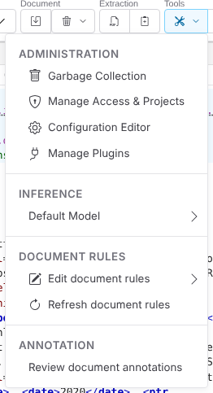

# Admin Guide

- [Installation](../development/installation.md)
- [User Management](./user-management.md)
- [Personal Access Tokens](./access-tokens.md)
- [Config Editor](./app-config.md)
- [Plugin Manager](./plugin-manager.md)
- [Import/Export — CLI, API, Backup](./import-export-admin.md)

Administrators reach the administration tools in the **Tools** menu of the toolbar, after the Document and Extraction buttons.

*The Tools menu of an administrator.*
