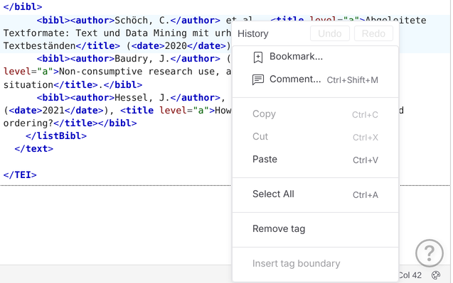
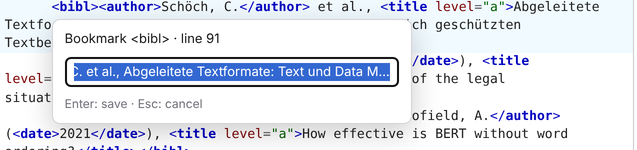
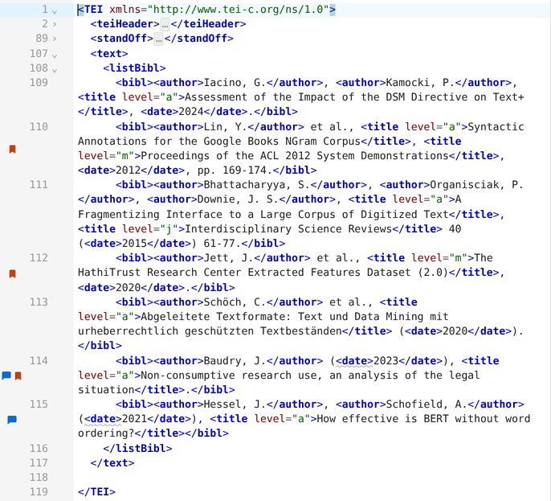
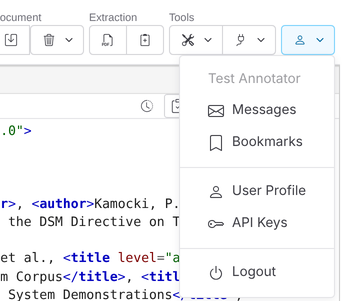
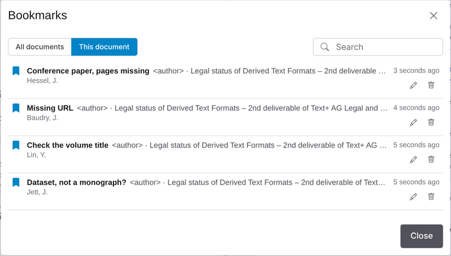

# Bookmarks

Bookmarks let you return to places in a document's text, for example entries you want to check later. They are **private**: only you see your bookmarks. They are not stored in the document, so you can also bookmark elements of documents you cannot edit.

## Adding a bookmark

1. Right-click an element inside the document's `<text>` in the XML editor.
2. Choose **Bookmark…** at the top of the context menu.
3. A small field asks for the title. It proposes the start of the element's text; type to replace it.
4. Press `Enter` to save, or `Esc` to cancel.

The entry is disabled outside `<text>`, for example in the `teiHeader` or the `standOff`. The bookmark points at the innermost element you right-clicked: right-click on the text of a `<bibl>` to bookmark the whole entry, or on the text of its `<author>` to bookmark the author.

## Bookmarks in the editor

The bookmarked elements of the open document are marked with an orange bookmark icon in the gutter of the XML editor, next to the line numbers. Bookmarks share this column with the speech bubbles of [unit comments](unit-comments.md): a line with both shows the bubble and the bookmark side by side. Hover over the icon to see the bookmark's title; a number on the icon shows several bookmarks on one line. Click the icon to select the bookmarked element. The markers follow the elements while you edit.

## The Bookmarks dialog

Open it with **Bookmarks** in the user menu, below **Messages**.

Each row shows the title, the bookmarked element and the document, the start of the element's text, and when the bookmark was added.

| Control | Effect |
| --- | --- |
| All documents / This document | Show all your bookmarks, or only those of the open document. The dialog opens with **This document** if the open document has bookmarks |
| Search | Filter the list by title, document or text |
| Pencil button on a row | Rename the bookmark (`Enter` saves, `Esc` cancels) |
| Trash button on a row | Delete the bookmark |

Click a bookmark to open its document with the bookmarked element selected and scrolled into view.

## Edits after bookmarking

A bookmark finds its element by the element's position in the document and a fingerprint of its content, like [unit comments](unit-comments.md). When elements are inserted or removed before it, the bookmark still finds the element by its content. If the element was changed and moved, or removed, the document opens without a selection and a warning says that the element was not found.

A bookmark belongs to one version of a document. When that version is deleted, its bookmarks are deleted with it, also those of other users. If you can no longer view the version, for example because you lost access to its collection, the bookmark is shown greyed out with the note "document not available" and can only be renamed or deleted.
