# Document Editing

The right panel of the PDF-TEI Editor contains a CodeMirror-based XML editor. This page describes the editor UI and the main editing workflows.

For the recommended division of labour between annotators and reviewers, from the extraction to the approval of a document, see [Review Workflow](review-workflow.md).

## Editor Layout

The XML editor panel has three chrome areas around the editing surface:

**Headerbar** (top strip)
Shows the artifact type prefix (**Gold:** or **Version:**), the artifact label, the document status (e.g. **Status: draft**, taken from the last revision and updated when a revision with a new status is saved; hidden if the document has no status), and the last revision date and author. Clicking the label copies it to the clipboard; double-clicking opens an inline rename prompt. When the editor has unsaved changes that cannot be auto-saved (e.g. because the XML is malformed), a warning badge appears here. When the document is read-only, a lock icon appears.

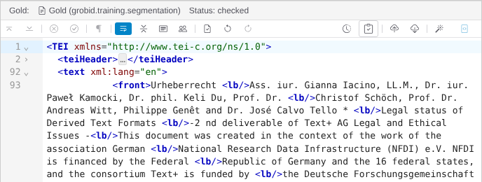

*The headerbar shows the version label and the document status.*

**Toolbar** (below the headerbar)
Contains action buttons grouped by function. What buttons are visible depends on the document state and your role (see [Toolbar buttons](#toolbar-buttons)).

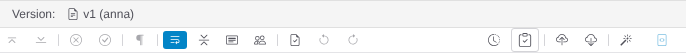

*Headerbar and toolbar of the XML editor.*

**Statusbar** (bottom strip)
Left side: the XML / Visual annotation mode toggle (only visible for variants that define annotation tags). Center: the XPath navigation controls and the **Focus** toggle. Right side: the review progress bar and the open comments counter (when the document has review marks or comments), indentation style, cursor position and, at the far right, the editor theme picker (palette icon). When the editor is narrow, items are hidden in this order: cursor position, theme picker, indentation style, then the left-side items, the review progress bar and the navigation controls. The open comments counter is hidden last.

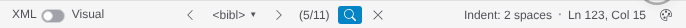

*The statusbar with the XPath navigation in the center.*

---

## Toolbar Buttons

The left part of the toolbar holds the editing controls. The right part is divided into three sections: document history and review, import and export, and the buttons that plugins add.

| Button / Control | When visible | What it does |
| --- | --- | --- |
| ← diff / → diff | Merge view active | Navigate between changed chunks |
| Current / Incoming (reject/accept all) | Merge view active | Accept or discard all incoming annotation changes at once |
| Strict diff (paragraph icon) | Merge view active | Treat whitespace and line breaks as significant in the diff |
| **Wrap** toggle | Always | Toggle soft line-wrapping in the editor |
| **Header** toggle | When document has a `<teiHeader>` | Fold or unfold the TEI header section |
| Edit header (card icon) | Not shown to annotators; enabled when the document is editable | Edit the metadata in the TEI header in a form |
| People (group icon) | Document loaded | List the [people of the document](document-people.md), add people (reviewers) and send them messages |
| Validate (✓ icon) | Always | Trigger a schema validation run and show errors inline |
| Undo / Redo | Always | Undo or redo editor changes |
| Revision history (clock icon) | When document has `<revisionDesc>` | Open the revision history panel |
| Review (clipboard icon) | Always | Switch [unit review](unit-review.md) mode on or off |
| Upload / Download | Annotator role | Replace the current XML from a local file, or download a copy |
| XSL viewer (file code icon) | Always; enabled when a plugin provides a stylesheet for the document's namespace | Preview the document rendered via an XSL transformation |

The theme picker sits at the far right of the statusbar. Available themes: **Default (light)**, **Dark**, **Color-blind friendly**, **High contrast**. The selection is saved per user and restored on the next visit.

Plugins can add further buttons to the right-hand section of the toolbar, for example:

| Button | Plugin | What it does |
| --- | --- | --- |
| TEI Wizard (wand icon) | TEI Wizard (ships with the application) | Menu of the TEI enhancements that apply to the document, see [Enhancing the TEI](#enhancing-the-tei) |

The XSL transformations listed by the XSL viewer are also provided by plugins (for example the GROBID plugin).

Saving a revision and deleting documents are done with the **Document** buttons in the main toolbar, not in the editor toolbar.

Buttons that are greyed out are disabled for the current document state or your role.

### Enhancing the TEI

The **TEI Wizard** (wand icon) opens a menu of enhancements that change the whole document. It lists only the enhancements that apply to the document's variant. Choose one to run it: the result is shown in the [merge view](#merge-view-comparing-versions), where you accept or reject the changes.

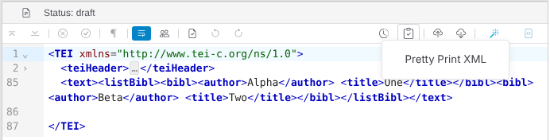

*The TEI Wizard menu.*

- **Pretty Print XML** (ships with the application) indents the document. If the document's variant has [review units](unit-review.md) (for example the references of a reference list), each unit is put on its own line, and its content is left as it is. In the TEI header, `<desc>` elements and elements that mix text and markup are left as they are.
- **Convert XML comments** (ships with the application) turns the XML comments in `<text>` into [unit comments](unit-comments.md#converting-xml-comments), after asking for confirmation.
- Plugins add further enhancements, for example **Enrich TEI Header from PDF Metadata** (metadata extraction plugin).

The button is disabled if you cannot edit the document or no enhancement applies to it.

---

## Editing the XML

You can type directly in the editor at any time the document is not read-only. The editor provides:

- Syntax highlighting with colour-coded tags and attributes
- Real-time well-formedness checking (red underlines for structural errors)
- Bracket and tag matching
- Line folding (click the gutter triangle to collapse a section)
- Find/Replace via **Ctrl/Cmd+F** / **Ctrl/Cmd+H**

**Auto-save:** The editor saves to the server automatically after each edit once the XML is well-formed. While the XML is malformed, edits are buffered locally as a draft and the headerbar shows a warning. The draft is restored the next time you open the document if the server save never completed.

**Right-click context menu:**

The entries that plugins add, such as **Bookmark…** and **Comment…**, come first, followed by the entries that change the markup and the clipboard operations.

| Item | What it does |
| --- | --- |
| Current / Incoming | Accept or discard one diff chunk (only shown inside a changed chunk in merge view) |
| Remove tag | Unwrap the tag at the cursor, preserving its text content |
| Split `<tag>` | Split the element at the right-clicked position (or at the cursor, if you right-click into the selection) into two elements of the same name. The second element gets the attributes of the first one except `xml:id`, and the cursor is placed at its start. Not available inside a tag, comment or entity, or in the root element. Also available in the [visual annotation mode](#splitting-an-annotation) |
| Split `<tag>` in new line | Shown instead of Split `<tag>` while you hold `Shift`: splits the same way and starts the second element on a new line, indented like the line on which the element starts |
| Copy / Cut / Paste / Select All | Standard clipboard operations |

To split an element, for example a `<body>` of a segmentation training document that covers two zones, right-click where the second part begins and choose **Split `<tag>`**. The entry shows the name of the element that will be split.

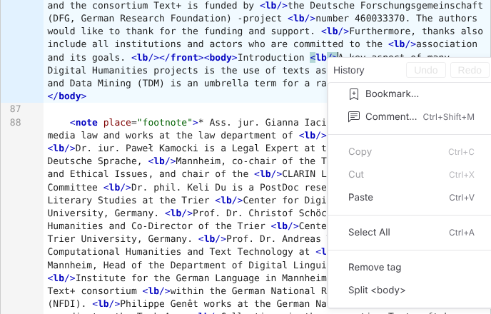

*The entry **Split `<body>`** splits the element that contains the cursor.*

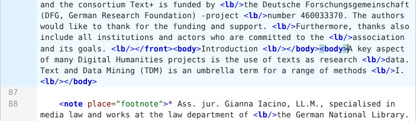

*After the split, the text after the cursor is in a second `<body>` element.*

Some entries of the context menu have a variant that is shown instead while you hold `Shift`, either when you right-click or while the menu is open. These entries are marked with **⇧**. Holding `Shift` turns **Split `<tag>`** into **Split `<tag>` in new line**, which puts the second element on its own line.

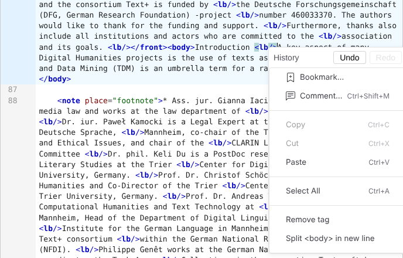

*With `Shift` held, the menu offers **Split `<body>` in new line**.*

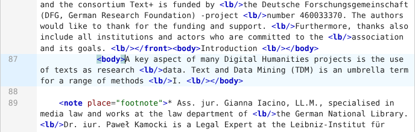

*The second `<body>` element starts on its own line.*

---

## XPath Navigation

The center of the statusbar contains node navigation controls. These are only shown once a document is loaded and the active variant has navigation XPath expressions. Annotators, reviewers and administrators also see the dropdown for variants without expressions, so that they can add some.

1. Use the dropdown to select an XPath expression (the list is variant-specific). Switching to another expression keeps your place in the document. It starts from the element at the cursor: if the new expression matches it or an element that contains it, that one stays selected, otherwise the next node of the new expression after the cursor is selected. If there is none after it, the first node of the document is selected.
2. Use the **‹** / **›** buttons to move between matching nodes; the counter (e.g. `3/15`) shows the current position.
3. Click the counter to jump to a specific node by number.

Each time you navigate, the node is scrolled to the vertical center of the editor and highlighted. Your XPath selection is remembered per-variant across sessions.

Node navigation is on while an XPath expression is selected in the dropdown. The **×** button at the end of the navigation group turns it off: the node loses its highlight or focus, the XPath selection is cleared, the **‹** / **›** buttons and the focus toggle are disabled, and the node is removed from the URL. Selecting an XPath expression in the dropdown turns navigation on again.

**Tools → Review document annotations** always reviews the whole document with the model selected in **Tools → Inference**. To review only the current node, use the **LLM Review** button in the bottom right corner of the focused node in focus mode. The suggestions of a review are kept for the browser tab: after an accidental reload, or when you return to the document, they are shown again without a new review, except those whose text you have changed in the meantime.

The current node is part of the page URL, as the `xpath` parameter next to the open document, in the form `(expression)[n]` for the n-th node of the expression, e.g. `xpath=(//tei:listBibl/tei:bibl)[3]`. After reloading the page you continue at the same node, and a copied URL opens the same document at the same node once the recipient has logged in.

### Editing the Navigation XPaths

The list of XPath expressions of a variant starts with the expressions that the extractor of the variant provides. Annotators, reviewers and administrators can add their own expressions with **Edit...** at the end of the dropdown:

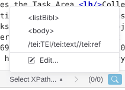

*The XPath dropdown with the "Edit..." entry.*

**Edit...** opens the **Navigation XPaths** dialog for the variant of the open document:

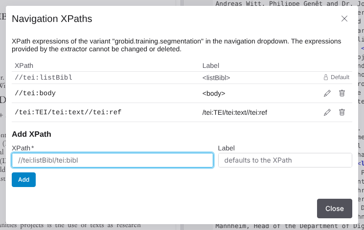

*The Navigation XPaths dialog.*

- The expressions of the extractor are marked **Default** and cannot be changed or deleted.
- To add an expression, enter it under **XPath** and, optionally, a **Label** for the dropdown, and click **Add**. Without a label, the dropdown shows the expression itself.
- The expression must be an absolute XPath 1.0 expression (starting with `/`) that selects elements. Use the prefix `tei:` for TEI elements, e.g. `//tei:listBibl/tei:bibl[@type="cited"]`. An invalid expression is not accepted and the dialog says what is wrong with it.
- The pencil button loads an added expression into the form to change it; **Save** stores the change. The trash button deletes it. Deleting the expression that the navigation currently uses turns the navigation off.

Changes are saved immediately and apply to all users of the installation. The list of other users is updated when they reload the page.

### Focus Mode

The magnifier button (**Focus**) next to the navigation controls, available while node navigation is on, turns on a distraction-free focus mode for working on one node at a time:

- Navigating centers the node vertically, as above, but instead of highlighting it, everything outside the node is dimmed. In the Visual annotation mode, the tag labels outside the node are dimmed as well.
- The focused node gets extra space above and below it.
- Line wrapping is turned on when focus mode is switched on. You can turn it off again with the **Wrap** switch; this does not change your saved wrapping preference.
- Moving the cursor into another node (for example by clicking) moves the focus to that node.
- In the XML mode, the **↑** and **↓** arrow keys move the focus to the previous or next node and center it. Within a node that spans several lines, they move the cursor line by line first; from the first or last line of the node they move on to the neighbouring node. At the first and last node they stop. This also works when the keyboard focus is not in the editor text, for example after clicking **‹** or **›**. In the Visual annotation mode, the arrow keys always go to the previous or next node, see [Activating annotation mode](#activating-annotation-mode).

Turn focus mode off by clicking the button again or by pressing **Esc**. The button is only available while the navigation controls are shown. Focus mode is on by default; whether you turned it on or off is remembered in your browser, so the choice is kept after reloading the page. Turning navigation off disables the focus toggle without changing this setting; focus mode applies again when navigation is turned back on.

---

## Leaving Focus and Merge Mode with Esc

Pressing **Esc** ends the current special editing mode:

1. If focus mode is on, Esc turns it off.
2. Otherwise, if a merge view is active, Esc closes it and returns to normal editing (the same as clearing the diff selection).

Esc is ignored while a dialog, drawer or dropdown is open, and when it is used to close the editor's search panel or autocomplete popup.

---

## The TEI Header

The `<teiHeader>` block is folded by default to keep the annotation text in view. Use the **Header** toggle in the toolbar to expand or collapse it. Your preference is saved and restored the next time you open a document.

---

## Validation

Click the **Validate** button to run a full schema validation against the TEI schema. Errors appear as red underlines in the editor; hovering over an underline shows the error message. All diagnostics (validation errors and annotation review suggestions) are also listed in the diagnostics drawer, see [Diagnostics drawer](#diagnostics-drawer). The total error count appears in a notification. If continuous validation is enabled by an administrator, validation runs automatically on each change.

---

## Diagnostics drawer

While the document has diagnostics, they are listed in a drawer on the left side, over the PDF. The drawer is shown when a document is loaded. When you click into the PDF viewer it slides out so the whole PDF is visible, leaving a **Diagnostics** button with the number of diagnostics in the top-left corner. It stays retracted while you edit the XML. To show it again, click the **Diagnostics** button, or the review progress meter or the open comments counter in the XML editor's status bar.

- Click a diagnostic to select the text it applies to in the XML editor.
- **Propose fix** (on annotation review suggestions) shows the change in the merge view, as in the editor tooltip.
- **Apply fix** (on diagnostics with a fix, such as annotation review suggestions) applies only this fix, without confirmation and without checking the diagnostic first. Like **Apply**, it closes the merge view.
- Check diagnostics, or use **Select all**, then click **Apply** to apply their fixes at once, without confirmation, or **Dismiss** to remove them. Both close the merge view. Diagnostics without a fix (such as validation errors) are kept by Apply. For reviewers (and admins), Dismiss also removes review entries (*Marked not OK*, *Review disputed*, *Changed after a not-OK review*) and open comments from the list, without changing the marks or comments themselves. They stay hidden until the document is loaded again or the entry changes, e.g. after a new mark or a reply. For annotators, these entries come back, since they are the reviewers' feedback. To remove them for good, reviewers and admins click **Delete** instead: it deletes the not-OK marks of the checked review entries (of all reviewers, including the LLM Reviewer; OK marks stay, so a disputed unit becomes OK) and the checked comment threads with their replies. Other checked diagnostics are dismissed. Delete is an edit of the document, so **Ctrl+Z** undoes it.
- When diagnostics are added, for example by a validation run or an LLM review, the list scrolls to show them. Added diagnostics that have a fix (such as LLM review suggestions) are checked, so that you can apply them right away; diagnostics without a fix (validation errors, comments, disputed reviews) are not checked, and the checks you set yourself stay as they are. Diagnostics that reappear after a re-validation, and those whose text you edited, do not count as added.

---

## Saving a Revision

Auto-save keeps the document up to date silently. To record a named checkpoint in the document's revision history, click the **Save revision** button (floppy disk icon). A dialog opens with:

- **Change description** — a short note describing what changed or the current annotation state. This is stored in the TEI `<revisionDesc>`.
- **Status** — the annotation lifecycle stage (e.g. *draft*, *annotation*, *review*, *done*). Available options depend on your role.
- **Save to a new personal version** — creates a copy so you can work without touching the original. Required if you are not the document owner in owner-based access control mode.
- **Clear reviews** — shown with *Save to a new personal version* to reviewers when the document has [unit review](unit-review.md) marks; the new version starts without them.
- **Keep comments** — shown with *Save to a new personal version* when the document has [unit comments](unit-comments.md); uncheck it to start the new version without them.
- **Save as gold version** — marks this document as the authoritative Gold Standard (reviewers only).

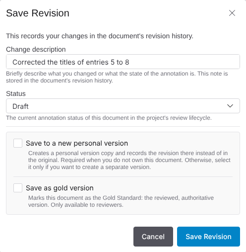

*The Save Revision dialog, as a reviewer sees it.*

### Documents opened by someone else

Only one window can edit a document at a time. When the document is already open for editing elsewhere, it opens read-only, and a notice says why:

- *This document is being edited by &lt;user&gt;*: another user has it open.
- *You have this document open for editing in another window or session*: you have it open yourself, in another tab, browser or after logging in again.
- A notice of a plugin, e.g. while a background job changes the document.

When the other window closes the document, or its user logs out, it becomes editable here and *You can now edit this document* appears.

### Superseded versions

As soon as a new version is saved from a version, the source version is superseded and becomes read-only for everyone, including administrators. This also applies to the Gold Standard. The status bar shows *Read-only (superseded by a newer version)*. To change a superseded version, use **Save revision** with *Save to a new personal version*, which is preselected for such versions. Deleting the newer version makes the source version editable again.

The **Target XML** and **Compare with version** menus list the versions of the document by line: the current versions that were copied from the same version come first, followed by the superseded versions they descend from, joined to them by a line with an arrow pointing up, and a divider separates one line from the next. The Gold Standard is marked with a medal icon wherever it appears in a line, and the lines that contain it come first. When a document is opened without choosing a version, its Gold Standard is loaded. Superseded versions can be opened (read-only), compared with the current one, or copied into a new version. The file drawer lists only the latest version of each line.

*The Target XML menu: two lines that descend from the Gold Standard, marked with a medal.*

**Delete > Delete current version with its history** deletes the current version together with the superseded versions it descends from, up to the first one that another version also descends from: that version and everything above it are kept, and so is the Gold Standard. For example, if a version was copied from a version that was itself copied from a third one, all three are deleted, unless another version was copied from the second or third. A confirmation lists the versions that will be deleted. The entry is available for current versions that were copied from another version; you need the right to delete each of the versions.

Each saved revision records a short hash of the document text in its `<change xml:id="h-…">`, chained to the hash of the previous revision. This makes it possible to check that the text of a recorded revision has not been changed afterwards.

---

## Reviewing and Commenting Documents You Cannot Edit

Reviews and comments do not need edit access, so that nobody has to make a copy just to give feedback:

| Role | In a document they can see but not edit |
| --- | --- |
| Annotator | Add [unit comments](unit-comments.md), reply to them, edit and delete their own comments |
| Reviewer | The same, and set [unit review](unit-review.md) marks |
| Admin | Everything (admins can edit every document that is not superseded) |

The text itself stays read-only: you can place the cursor, select and use the review and comment shortcuts, but not type. Your marks and comments are saved as usual; the server takes only your own marks and comments from the document and leaves everything else as it is. The owner and other users keep theirs: when the owner saves the document, the marks and comments that others added meanwhile are kept.

Only the current version of a document can be reviewed and commented. A superseded version (see [Superseded versions](#superseded-versions)) takes no reviews or comments, so that feedback always goes to the version that is being worked on.

The workflow between an annotator and a reviewer (see [Review Workflow](review-workflow.md) for a detailed, step-by-step version with screenshots):

1. The annotator works on their version.
2. The reviewer opens it, marks units as not OK and comments, in the annotator's version. The annotator gets a [message](messages.md) for each not-OK mark and each comment addressed to them.
3. The annotator corrects the units and answers the comments, again in the same version. A reviewer who has the version open sees the changes a few seconds after each save: when another user saves a document you cannot edit, the changed parts are updated in place, so the scroll position, folded sections and open popovers stay (your own unsaved marks and comments are saved first; if most of the document changed, it is reloaded instead). In the other direction, the reviewer's marks and comments appear in the annotator's open version right away, without a reload: a unit turns green as soon as the reviewer marks it OK, and new, edited, deleted, resolved and reopened comment threads show up as well.
4. When the reviewer is satisfied, or wants to take over for the final polishing, the reviewer saves the document to a new personal version (Save Revision → *Save to a new personal version*), which supersedes the annotator's version.

The LLM Reviewer records its marks only in documents you can edit.

## Revision History

Click the clock icon in the toolbar to open the revision history panel. It lists all `<change>` entries from the TEI `<revisionDesc>` in reverse chronological order, showing date, description, status, and the responsible person. The button is hidden when the document has no `<revisionDesc>`.

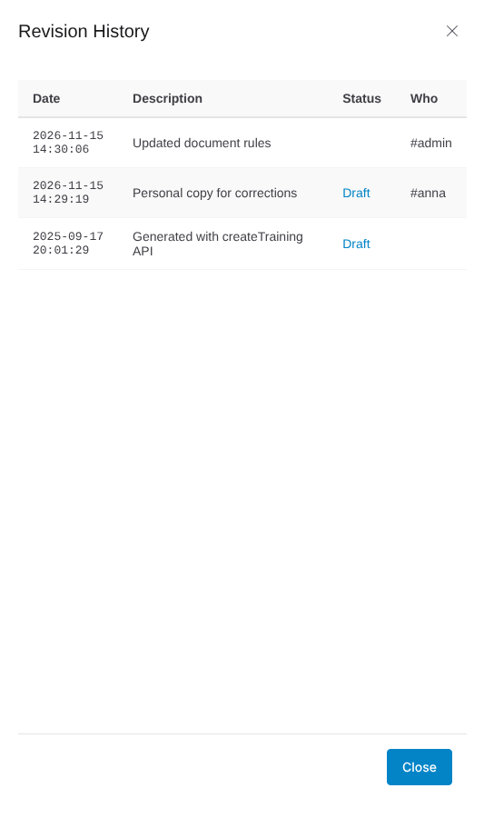

*The Revision History drawer.*

---

## Merge View (Comparing Versions)

When a diff document is selected in the toolbar, a side-by-side merge view activates. The diff navigation buttons and reject/accept controls highlight in the toolbar. You can:

- Use **← diff / → diff** to jump between changed chunks.
- Click **Current** (orange) in the context menu or toolbar to keep the editor text for a chunk.
- Click **Incoming** (blue) to apply the diff version for a chunk.
- Use **Reject all** / **Accept all** to resolve all chunks at once.

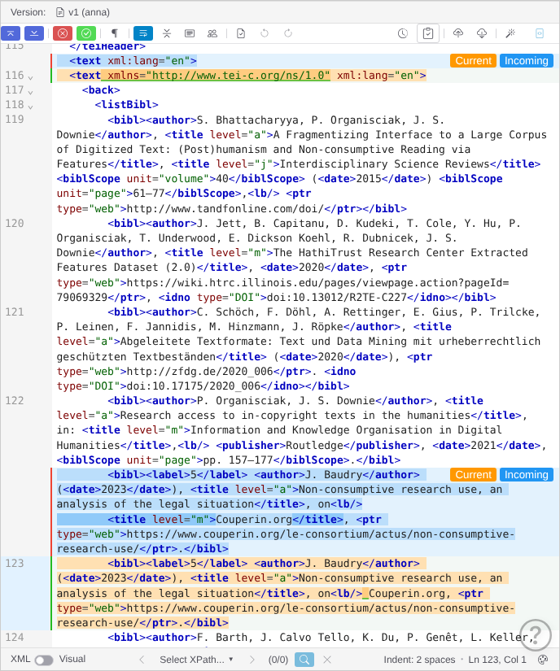

*The merge view with one changed chunk.*

---

## Visual Annotation Mode

The XML editor includes a visual annotation mode that hides raw XML markup and lets you annotate text spans using a point-and-click chip palette. This is the recommended way to create GROBID training data for extraction variants that define annotation tags.

### Availability

The annotation mode toggle only appears in the editor statusbar when the active extraction variant provides annotation tag definitions. The following GROBID variants currently support it:

| Variant | Tag set |
| --- | --- |
| `grobid.training.segmentation` | body, listBibl, front, titlePage, note, page, div (acknowledgement, toc, annex, funding, conflict, contribution, availability) |
| `grobid.training.references.referenceSegmenter` | bibl, bibl[footnote], label |
| `grobid.training.references` | author, title (a/j/m/s), date, biblScope (pages/volume/issue), publisher, orgName, pubPlace, editor, ptr (URL), idno, note |

### Activating annotation mode

Click the **XML / Visual** toggle switch in the bottom-left of the XML editor statusbar. When it switches to **Visual**:

- Raw XML tags are replaced by colored inline badges (e.g. `AUTHOR`, `TITLE[A]`).
- Direct text editing is disabled — the editor is read-only for free-form changes. The cursor and the keyboard shortcuts that do not change the text, such as the [review shortcuts](unit-review.md#marking-units), still work.
- While node navigation is on, the **↑** and **↓** arrow keys go to the previous or next node, like **‹** and **›**, with or without focus mode, instead of moving the cursor.
- The XPath navigation header is hidden to keep the view clean.
- The editor scrolls to the start of the `<text>` element.

Click the toggle again (back to **XML**) to return to the standard XML view.

![The XML editor in Visual mode: the reference entries with colored badges such as AUTHOR, TITLE[A], DATE and PTR[WEB] in front of the annotated text](../images/editing-workflow-visual-mode.png)

*The visual annotation mode of a `grobid.training.references` document.*

### Wrapping a text span

1. Select the text you want to annotate by clicking and dragging.
2. Release the mouse. A popup appears near the cursor showing one colored chip per available annotation tag.
3. Hover over a chip to see its description in a tooltip.
4. Click the chip to wrap the selection. The tag is inserted with any mandatory default attributes (e.g. `<note place="footnote">`) automatically.

The editor rebuilds its decoration layer immediately after each wrapping operation.

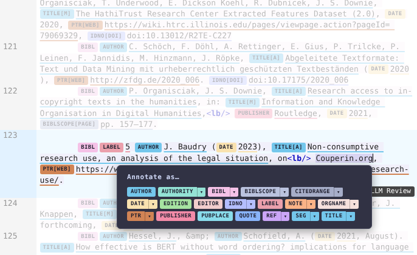

*The chip palette after selecting "Couperin.org".*

### Editing annotation attributes

Click any colored badge in the annotation view to open an attribute popup:

- Attributes with a fixed list of values (e.g. `level` on `<title>`) appear as dropdown selects.
- Free-form attributes (e.g. `when` on `<date>`) appear as text inputs.

Changes are applied to the underlying XML as you make them. Click outside the popup or press **Escape** to dismiss it. Clicking a badge does not move the cursor or select its element; to select an element, click its text.

### Changing a tag

The attribute popup includes a **Change to** chip palette at the bottom. Click any chip to retag the annotated element to a different annotation type. The element's content is preserved; mandatory default attributes for the new tag type are applied automatically.

### Merging annotations

The attribute popup includes two merge operations for consolidating adjacent annotated spans of the same type:

- **« Merge with previous** — absorbs the current element's content into the nearest preceding sibling element, including any intermediate text, preserving reading order.
- **» Merge with next** — same, targeting the nearest following sibling element.

If no element sibling exists in the given direction, the element is unwrapped in place (equivalent to **Remove annotation**).

Use these commands when a single logical annotation has been split across two spans, for example after correcting a word boundary or combining two separately tagged author names into one.

### Splitting an annotation

Right-click where the second part of an annotated span begins and choose **Split `<tag>`** in the context menu. The element is split into two elements of the same type, each with its own badge. This is the counterpart of the merge commands, for example when one `<body>` of a segmentation document covers two zones.

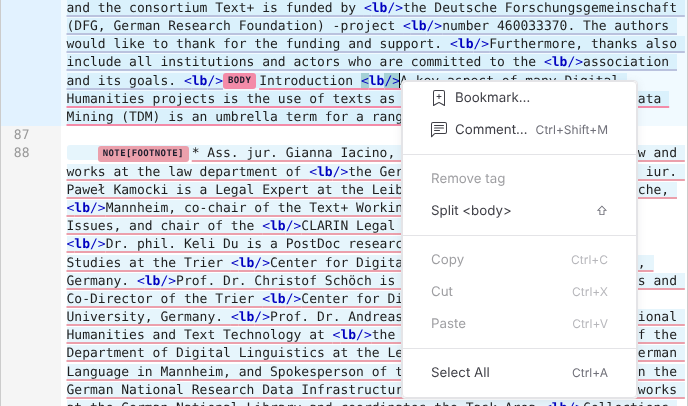

*Splitting an annotation in the visual mode.*

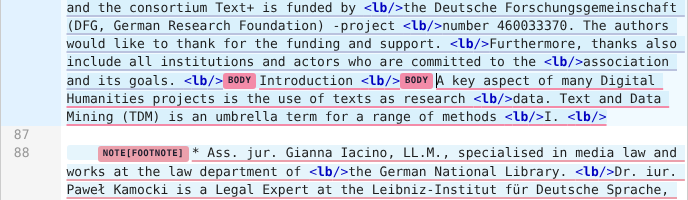

*After the split, a second badge marks the start of the new element.*

### Removing an annotation

Click the badge to open the attribute popup, then click the **Remove annotation** link at the bottom. The element is unwrapped and its text content is restored.

### Saving

Annotation mode operates on the live document content. Save the document normally (e.g. with the Save revision button) — annotation mode does not affect the save workflow.
