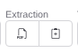
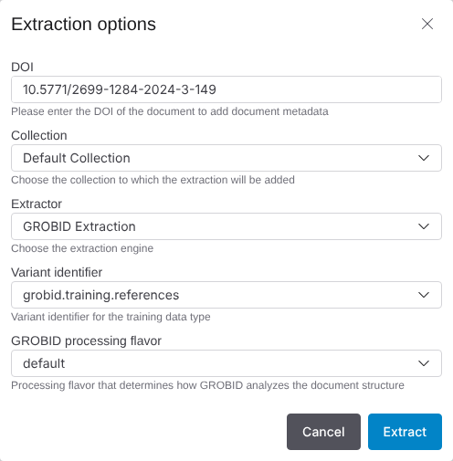
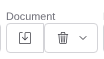
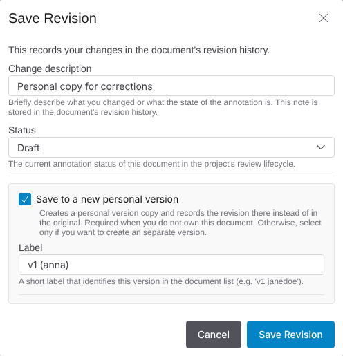
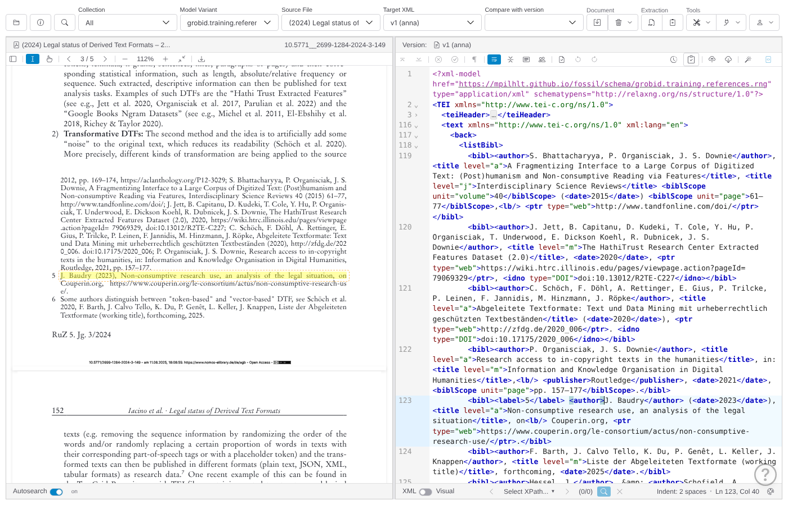
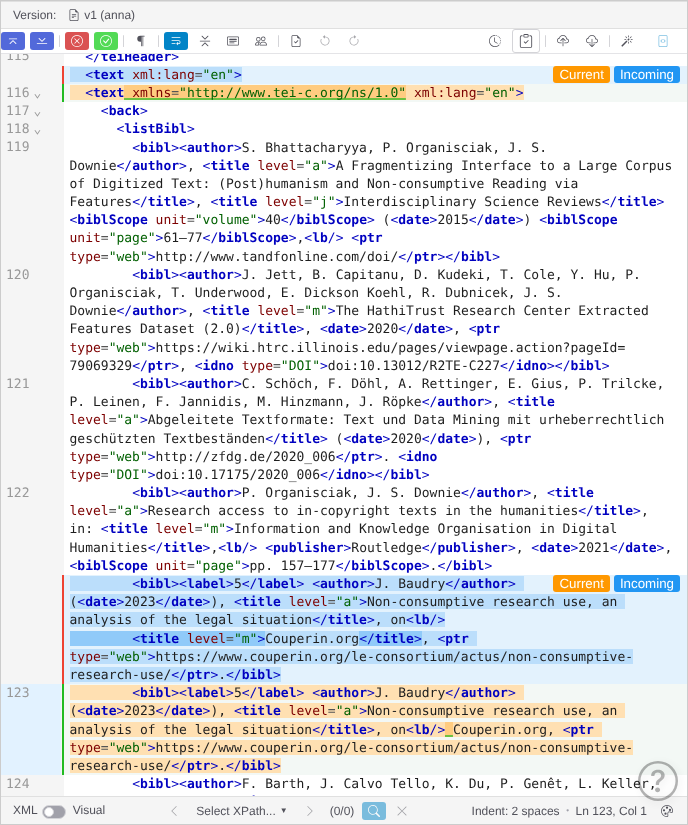

# PDF-TEI Editor Workflow for Training/Evaluation Datasets

For the creation of datasets that are to be used to train models or evaluate their performance, the basic workflow of the PDF-TEI Editor is this:

1. Extract data from PDF into first "gold" draft
2. Create a version and edit this version, saving one or more revisions
3. Compare the version with the "gold" version, review it and make it the new "gold" version
4. Retraining of models, revision of prompts

This workflow provides isolation of edits and an explicit audit trail that links edits with annotators. This trail is stored in the `<teiHeader>` element in the document.

### 1. Extract data from PDF

(Reviewer role)

*The Extraction button group.*

By clicking on the first button in the "Extraction" button group, choose a PDF, which is uploaded. The second button extracts again from the PDF that is open.

You are then asked to edit the extractor configuration

*The Extraction options dialog with the GROBID extractor.*

If the PDF has a DOI, enter it here to retrieve document metadata which will automatically be added to the TEI header element. 

Choose the extractor, which in most cases will be "Grobid" or "Llamore". This will then show additional configuration options:

- The "Grobid" extractor has different extraction models ("segmentation", "reference", etc.), which each constitute a variant. You can also select a custom "flavour", tied to a particular type of training data.
- the "LLamore" extractor lets you select "Instructions" which are added to th prompt and can be edited by clicking on the third button in the button group. 
- The "LLamore" extractor uses the LLM model shown in the dialog, which is the one selected under Tools > Default Model. Administrators set the default model for everyone (the app asks them to confirm this); other users can pick another permitted model for their session. Administrators also see a clipboard button next to each model, which copies its full id (`<provider>/<model>`, e.g. `kisski/llama-3.3-70b-instruct`) for use in scripts such as the auto-annotation model probe (`--model`).

Then, click on "Extract", this starts the extraction and produces a first version of the "gold" file, which refers to the "gold standard" dataset with the corrected and reviewed annotation data.

### 2. Versions, corrections and revisions

(Annotator role)

Unless the selected model has been trained with suffient high-quality data, the first extraction will contain many errors and omissions, which need to be corrected according to the annotation rules specific to the target model which the annotators have received.

Edits are always be done in copies, which merged by the reviewers into the "gold" version when they are ready.

*The Document button group.*

- To create a copy of "gold", click on the "Save revision" button in the "Document" button group () and check "Save to a new personal version". The "Label" field proposes a name which identifies the version (e.g. "v1 (anna)"); you can change it. Describe the purpose of the copy in the "Change description" field. This creates a new version of the TEI document.

*Creating a personal copy with the Save Revision dialog.*

- Work on this document as instructed by the annotation rules until you are ready to submit it to a reviewer. 

- By toggling "Autosearch" () in the footer of the PDF Viewer, you can search the contents of the current entry (e.g. a `<bibl>` or `<biblStruct>`) in the PDF automatically, for any extraction. It works well in most documents; results can be off if the PDF's underlying text extraction is poor (e.g. scanned pages, unusual column layouts, or heavy OCR artifacts), so treat the highlighted region as a starting point and verify it against the page.

*Autosearch highlights the text of the current entry in the PDF.*

- You can leave comments anywhere by enclosing them in the xml comment markup: `<!-- this is a comment -->`
- When you are done, click on the "Save revision" button (). In the dialog's "Description" field, you can specify more exactly what you have been correcting, and add addtional comments if needed.

### 3. Review the version and make it the "gold" version

(Reviewer role)

Once annotators have finished their work:

- By selecting the annotator's version in the "Target XML" selectbox and the gold version in the "Compare with version" selectbox, reviewers can compare the annotator's changes with the "gold" version. Since the annotator's copy supersedes the gold version, the gold version is read-only (see [Superseded versions](editing-workflow.md#superseded-versions)).

*Comparing the annotator's version with the gold version.*

- The editor shows the differences visually. For each changed chunk, "Current" keeps the text of the open version and "Incoming" takes the text of the compared version. The buttons at the left of the XML editor toolbar navigate between the changes and accept or reject all of them.

*The merge view: the annotator removed the `<title>` markup around "Couperin.org".*

- When the version is correct, save a revision with "Save as gold version" checked. See [Review Workflow](review-workflow.md) for the review of the individual entries and the approval.
- It is recommended to keep the versions for later reference.

### 4. Retraining of model with gold dataset

When a batch of training data has been corrected, the "gold" standard can be downloaded and used to retrain the extraction models. 

