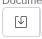
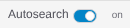
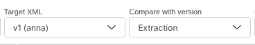

# PDF-TEI Editor Workflow for Training/Evaluation Datasets

For the creation of datasets that are to be used to train models or evaluate their performance, the basic workflow of the PDF-TEI Editor is this:

1. Extract data from PDF into first "gold" draft
2. Create a version and edit this version, saving one or more revisions
3. Compare the version with the "gold" version, review it and make it the new "gold" version
4. Retraining of models, revision of prompts

This workflow provides isolation of edits and an explicit audit trail that links edits with annotators. This trail is stored in the `<teiHeader>` element in the document.

### 1. Extract data from PDF

(Reviewer role)

*The Extraction button group.*

By clicking on the first button in the "Extraction" button group, choose a PDF, which is uploaded. The second button extracts again from the PDF that is open.

You are then asked to edit the extractor configuration

*The Extraction options dialog with the GROBID extractor.*

If the PDF has a DOI, enter it here to retrieve document metadata which will automatically be added to the TEI header element. 

Choose the extractor, which in most cases will be "Grobid" or "Llamore". This will then show additional configuration options:

- The "Grobid" extractor has different extraction models ("segmentation", "reference", etc.), which each constitute a variant. You can also select a custom "flavour", tied to a particular type of training data.
- the "LLamore" extractor lets you select "Instructions" which are added to th prompt and can be edited by clicking on the third button in the button group. 
- The "LLamore" extractor uses the LLM model shown in the dialog, which is the one selected under Tools > Inference > Default Model (see [Choosing a language model](language-models.md)). Administrators set the default model for everyone (the app asks them to confirm this); other users can pick another permitted model for their session. Administrators also see a clipboard button next to each model, which copies its full id (`<provider>/<model>`, e.g. `kisski/llama-3.3-70b-instruct`) for use in scripts such as the auto-annotation model probe (`--model`).

Then, click on "Extract", this starts the extraction and produces a first version of the "gold" file, which refers to the "gold standard" dataset with the corrected and reviewed annotation data.

#### Text recognition (OCR)

Extractors read the text layer of the PDF. Scanned PDFs have no text layer, and older scans often have one of poor quality. Digital PDFs can have a broken text layer too: the characters can be garbled, or the text can be stored at other places or in another order than it is shown on the page. Below the extractor options, the dialog shows the result of a check of the text layer and the option "Apply text recognition before extraction":

- If the PDF has no text layer, the option is checked and cannot be unchecked.
- If the text layer is of poor quality, the option is checked, with the problems listed below it. You can uncheck it. Problems are garbled characters, many implausible words, text that does not read as natural language, scanned pages without text, and text that does not match the page (see below).
- If the text layer looks fine, the option is unchecked. If you check it anyway, the text layer is replaced, since the check cannot find all problems.

The check runs in two steps. The first looks at the characters of the text layer and takes a moment. If it finds no problem, the text recognition engine reads up to three sample pages and compares the words it finds with the text layer: whether they are the same words, at the same places and in the same order. This takes a few more seconds; the dialog shows "Comparing the text layer with the page images…" meanwhile.

Choose the text recognition engine and click "Configure OCR options" to choose the languages of the document and the engine parameters. By default, the language declared in the document or the language detected in the text layer is used. The parameters are remembered for the next extraction.

The OCRmyPDF engine has these parameters:

- **Mode**: "auto" chooses from the state of the text layer:
  - "skip" recognizes only pages without text
  - "redo" replaces an existing OCR text layer
  - "vectorize" replaces a digital text layer and keeps the pages as they are: the text is converted to vector outlines, which look the same but contain no text, and the pages are recognized again. This is used for broken digital text layers, PDFs with some scanned pages, and when you ask for text recognition although the text layer looks fine.
  - "force" turns all pages into images and recognizes them again.
- **Rasterize if needed**: if "vectorize" is not possible, turn the pages into images instead ("force"). This happens if the PDF is encrypted, if the conversion would change how the pages look, or makes the file too large. The pages then lose their vector graphics, and the file is usually much larger. A message tells you when this happened, and the text layer check of the PDF mentions it later. Uncheck the option to get an error instead.
- **Straighten skewed pages**: rotates crooked scans by small angles before recognition. It is not applied when the pages are kept as vector graphics.
- **Fix page orientation**: turns pages that are upside down or sideways. This changes the page orientation, so coordinates in existing annotations may no longer match.

Tesseract, which the OCRmyPDF engine uses, reads small superscript footnote markers as punctuation or quotation marks: `tut³¹²⁾` becomes `tut?!?)`, `Regel¹²` becomes `Regel"`, and a footnote that starts with a superscript number, `¹² Vgl.`, becomes `» Vgl.`. The engine corrects such markers: it reads them again on their own and takes the number that fits the numbering of the footnotes in the document. A marker is only changed if the document has numbered footnotes and the number read fits them, so other text is left as it is. The message at the end of the recognition says how many markers were corrected. This covers markers with and without a closing parenthesis (`Wort¹²)`, `Wort¹²`, `Wort.¹²`) and superscript footnote numbers at the start of the footnotes. Markers that cannot be read are left unchanged and have to be corrected by hand, as are markers that Tesseract drops or reads as letters.

Text recognition replaces the stored PDF with the result. The PDF keeps its identifier, and the improved text layer is used by new extractions and by the PDF viewer, for example by Autosearch. If the document already has TEI versions, the original PDF is kept: these versions were made from its text layer, so they are shown with the original PDF, and the footer of the PDF viewer says "Original PDF (before text recognition)". New versions copied from them keep the original PDF as well. The original PDF is not listed as a document of its own; garbage collection removes it once no version made from it is left. Text recognition can take a minute or more for long documents.

#### Finding OCR errors with a language model

Text recognition leaves errors that the footnote correction does not cover: misread letters, wrong characters, garbled footnote numbers. For a segmentation document with line coordinates (such as `grobid.training.segmentation`), a language model can look for them. Choose "Tools > OCR > Find OCR errors (LLM)", then the provider and model. The document is reviewed page by page, with some lines of the neighbouring pages as context. Alternatively, focus a node in the XML editor and click "LLM OCR review" to review only the pages of that node.

The model suggests corrections for lines. They are shown as diagnostics in the XML editor and in the diagnostics panel, with the old and the new text and a rationale. Use "Propose fix" or "Apply" to take over a suggestion. A suggestion is dropped if

- its text cannot be found exactly once in the document,
- it would change markup (text that spans a tag, comment or line break), or
- the letters of the old and the new text are too different. Corrections of footnote numbers, such as `?!?)` to `312)`, are kept, since only letters are compared.

The model is told to check the numbering of footnotes. A footnote marker that only fits the numbering is corrected, but the model can be wrong, so check each suggestion. The suggestions of a document are kept for the browser session and shown again when you reopen the document.

Applying a suggestion changes the TEI document only. To correct the text layer of the PDF, save the document and then use "Write text corrections to PDF" (next section).

#### Writing text corrections to the PDF

If you corrected words in the TEI document that the text recognition got wrong, you can write these corrections back into the text layer of the PDF, so that Autosearch, the PDF viewer's text selection and new extractions use the corrected text. This is available to reviewers and administrators, in the menu "Tools > OCR > Write text corrections to PDF".

The action compares the text of the open TEI version with the text layer of its PDF. A dialog lists the words that would be corrected, the differences that cannot be written, and the other versions of the document that are affected. Only words that were replaced by other words are corrected; the position and size of the words in the layer do not change. Differences that are only a matter of splitting or joining words or of the order of text blocks are ignored.

After you click "Write", the dialog stays open until the corrections are written, which can take a minute. The stored PDF is replaced by the corrected one and the original PDF is archived, as after text recognition. The version you are editing is kept with the corrected text and stays linked to the archived original PDF. A new version of the document, based on the corrected PDF and with the line coordinates updated for it, is created from it and opened together with the corrected PDF. Further corrections are written from this new version. If the new version cannot be opened, for example because the connection was lost, it exists nevertheless: open the newest version of the document in the file selection. Other versions of the document stay linked to the archived original PDF and are shown with it. The corrections are recorded in the metadata of the PDF.

The action is refused, with a message that says why, in these cases:

- The open version was made from an earlier PDF than the current one. Open a version that is based on the current PDF.
- The document is open read-only, because it is edited in another session or you cannot edit it.
- The document has changes that could not be saved, for example because the XML is not well-formed. Fix and save it first.
- Text recognition is running for the PDF of the document.
- The document has no text corrections, or the PDF has no invisible text layer from text recognition. Visible text of the PDF is never changed.
- The text layer cannot be changed, for example because of an unusual font encoding.
- Some differences cannot be written (a different number of words in a line, unrelated text, pages without text layer). You can skip them and write the other corrections.
- The PDF was changed while the corrections were written. Try again.
- The extraction service of the document's variant is not reachable, or reports that the corrected PDF no longer matches lines of the document that matched before. Nothing is replaced in these cases.

### 2. Versions, corrections and revisions

(Annotator role)

Unless the selected model has been trained with suffient high-quality data, the first extraction will contain many errors and omissions, which need to be corrected according to the annotation rules specific to the target model which the annotators have received.

Edits are always be done in copies, which merged by the reviewers into the "gold" version when they are ready.

*The Document button group.*

- To create a copy of "gold", click on the "Save revision" button in the "Document" button group () and check "Save to a new personal version". The "Label" field proposes a name which identifies the version (e.g. "v1 (anna)"); you can change it. Describe the purpose of the copy in the "Change description" field. This creates a new version of the TEI document.

*Creating a personal copy with the Save Revision dialog.*

- Work on this document as instructed by the annotation rules until you are ready to submit it to a reviewer. 

- By toggling "Sync with editor" () in the footer of the PDF Viewer, you can search the contents of the current entry (e.g. a `<bibl>` or `<biblStruct>`) in the PDF automatically, for any extraction. It works well in most documents; results can be off if the PDF's underlying text extraction is poor (e.g. scanned pages, unusual column layouts, or heavy OCR artifacts), so treat the highlighted region as a starting point and verify it against the page. If no sufficiently similar text is found, a message next to the switch says so for five seconds, or until a later search finds a match.

*"Sync with editor" highlights the text of the current entry in the PDF.*

- Use XML comments (`<!-- this is a comment -->`) only for remarks that must stay in the document permanently and become part of the published dataset, for example a note explaining an anomaly in the source that is preserved on purpose. For all other remarks, such as questions to the reviewer or notes on open issues, use [unit comments](unit-comments.md).
- When you are done, click on the "Save revision" button (). In the dialog's "Description" field, you can specify more exactly what you have been correcting, and add additional comments if needed.

### 3. Review the version and make it the "gold" version

(Reviewer role)

Once annotators have finished their work:

- By selecting the annotator's version in the "Target XML" selectbox and the gold version in the "Compare with version" selectbox, reviewers can compare the annotator's changes with the "gold" version. Since the annotator's copy supersedes the gold version, the gold version is read-only (see [Superseded versions](editing-workflow.md#superseded-versions)).

*Comparing the annotator's version with the gold version.*

- The editor shows the differences visually. For each changed chunk, "Current" keeps the text of the open version and "Incoming" takes the text of the compared version. The buttons at the left of the XML editor toolbar navigate between the changes and accept or reject all of them.

*The merge view: the annotator removed the `<title>` markup around "Couperin.org".*

- When the version is correct, save a revision with "Save as gold version" checked. See [Review Workflow](review-workflow.md) for the review of the individual entries and the approval.
- It is recommended to keep the versions for later reference.

### 4. Retraining of model with gold dataset

When a batch of training data has been corrected, the "gold" standard can be downloaded and used to retrain the extraction models. 

### Extraction with plugins

<!-- plugin-docs: extraction hide-heading -->
