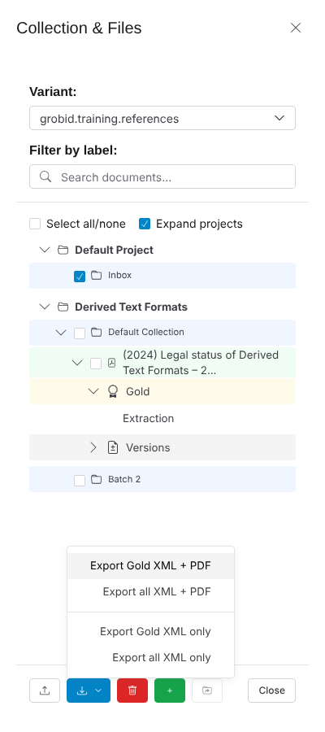

# Importing and Exporting Files

This page explains how to import and export files using the web interface. For bulk CLI imports, the REST API, and backup procedures, see [Import/Export — Administrator Guide](./import-export-admin.md).

## Exporting Collections

The export button in the File Selection Drawer downloads a ZIP archive of selected collections.

1. Open the **File Selection Drawer** by clicking the list icon (<sl-icon name="list"></sl-icon>) in the toolbar.
2. Check the collections you want to export. Use the **Select all / none** toggle to change all checkboxes at once.
3. Optionally choose a **variant** from the variant dropdown to narrow the export: only PDF/TEI pairs where the TEI file matches the chosen variant are included.
4. Click the export button (<sl-icon name="download"></sl-icon>) and choose what to export: the gold XML files with the PDFs, all XML versions with the PDFs, only the gold XML files, or all XML versions without the PDFs. A ZIP file is downloaded.



*Exporting a collection from the Collection & Files drawer.*

The ZIP is organised by collection:

```text
export.zip
├── collection1/
│   ├── pdf/
│   │   └── document.pdf
│   └── tei/
│       └── document.tei.xml
└── collection2/
    └── ...
```

The "Gold" options include only the **gold standard** TEI file of each PDF, the "all" options also the versions.

## Importing a ZIP Archive

The import button accepts a ZIP archive and adds its contents to the application.

1. Open the **File Selection Drawer**.
2. Click the import button (<sl-icon name="upload"></sl-icon>, left of the export button in the drawer footer).
3. Select a ZIP file from your computer.
4. A progress indicator appears during upload and processing.
5. On completion, a notification shows how many files were imported and the file tree refreshes automatically.

The ZIP can use any of these layouts — the importer detects the structure automatically:

| Layout | Example |
| --- | --- |
| Type-grouped | `pdf/doc.pdf`, `tei/doc.tei.xml` |
| Collection-grouped | `corpus1/pdf/doc.pdf`, `corpus1/tei/doc.tei.xml` |
| Flat collection | `corpus1/doc.pdf`, `corpus1/doc.tei.xml` |
| Variant-grouped | `pdf/doc.pdf`, `grobid-0.8.1/doc.tei.xml` |

Collections named in the directory structure are created automatically if they do not already exist. Duplicate files (same content) are skipped silently.
