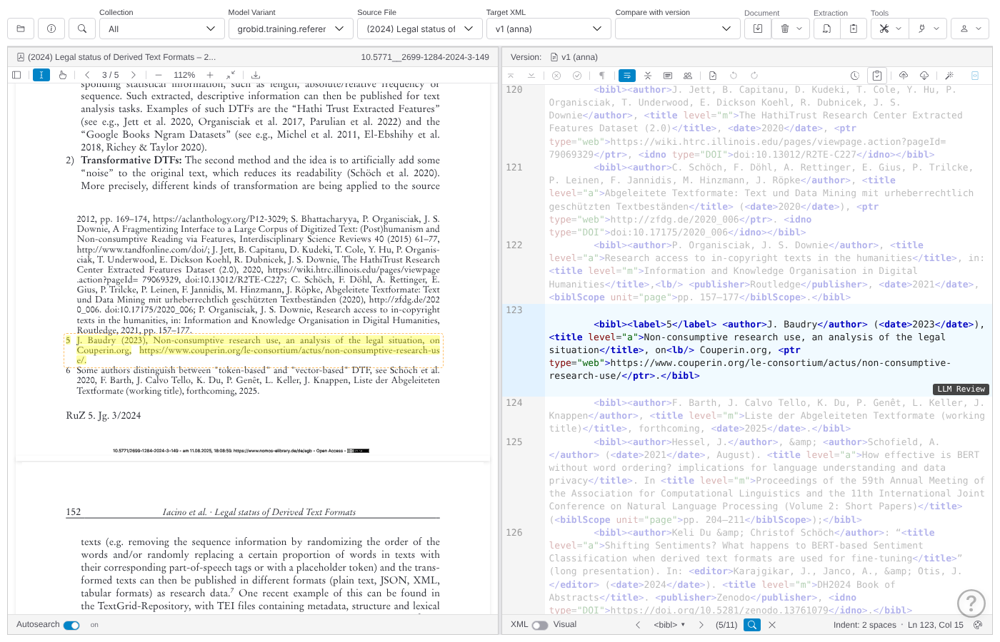
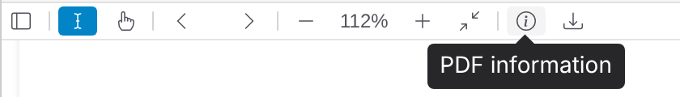
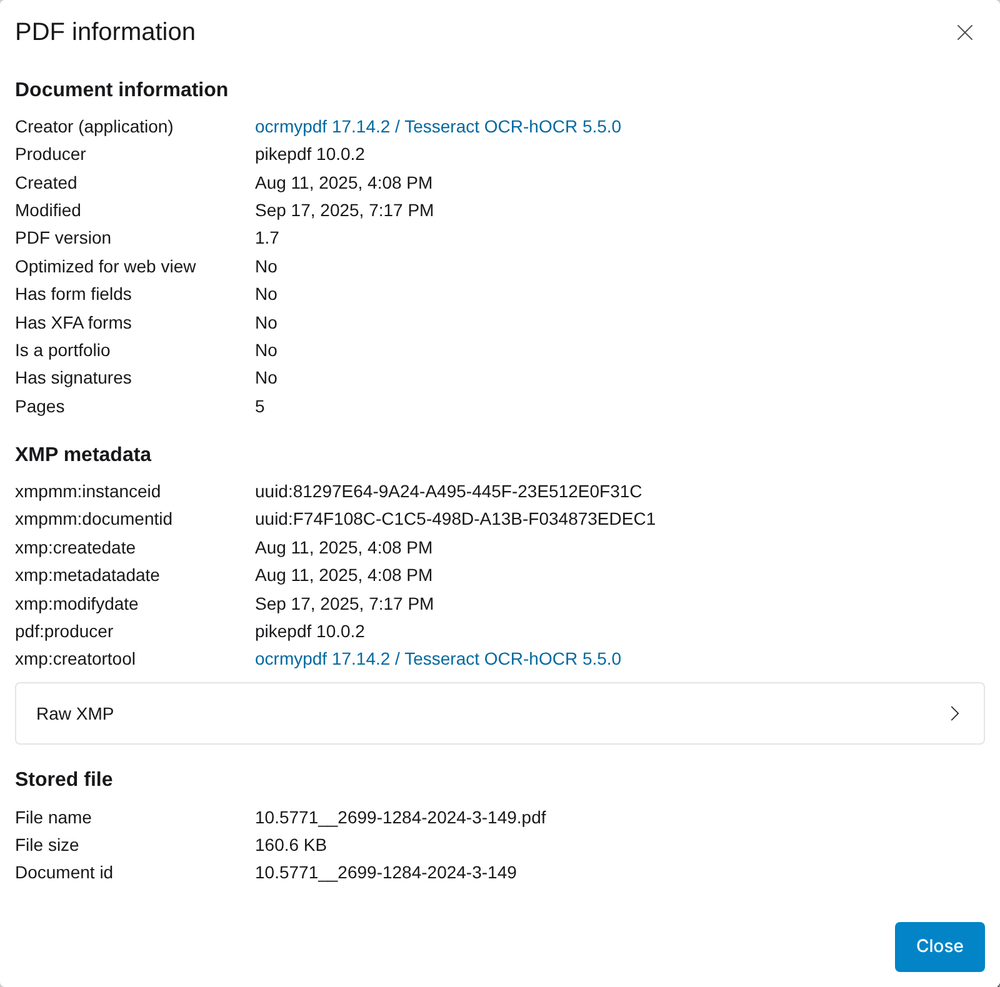
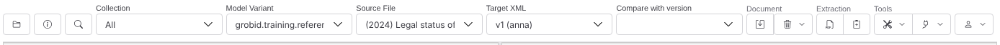
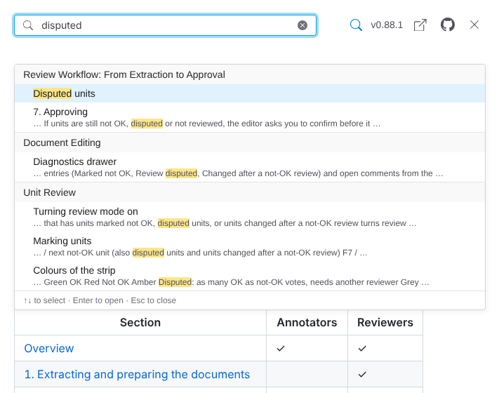
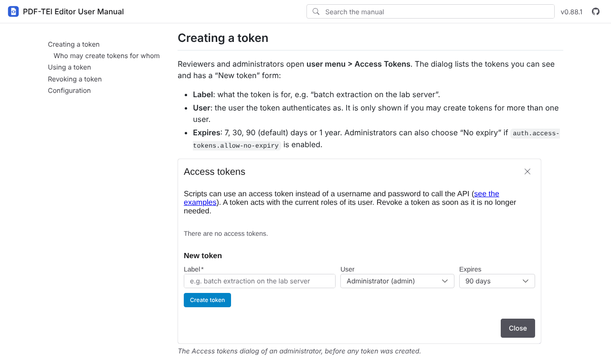

# Interface Overview

The PDF-TEI Editor features a two-panel layout designed for efficient comparison and editing of PDF documents and their corresponding TEI markup.

*The PDF viewer (left) and the XML editor (right). "Sync with editor" highlights the entry of the current `<bibl>` in the PDF.*

## Main Layout

### Left Panel: PDF Viewer

The left panel contains the PDF document viewer, which offers the following functionality shipped with the standard PDF.js viewer.

- **Header Bar**: Document title and document id 
- **Document Navigation**: Page controls, zoom, and search functionality
- **PDF Toolbar**: Standard PDF viewing tools including zoom, page navigation, and text selection
- **Page Display**: Shows the source PDF document with footnotes and bibliographic references

The header bar of the PDF viewer provides the following information:

- on the left, the PDF document title which is taken from document metadata. 
- on the right, the document id which is used to identify the PDF and all TEI annotations (regardless of variant) that belong to it.

Both values can be copied by single-click, in addition, administrators can change title and id by double-clicking.

In the status bar of the PDF viewer, you can toggle the "Sync with editor" feature, which tries to automatically navigate to the position within the PDF that corresponds to the cursor position in the XML Editor. In documents with page markers (`<pb/>`), it also works the other way round: when you page through the PDF, the XML Editor scrolls to the page marker of that page, without moving the cursor. Page markers also make the lookup itself more reliable: text is first searched only on the page that the preceding page marker points to, so that short or repeated text such as running heads, footers and page numbers is found on the right page. It works well on most documents; results can be less reliable when the PDF's underlying text extraction is poor (e.g. scanned pages or unusual layouts).

#### PDF information

The <sl-icon name="info-circle"></sl-icon> button in the toolbar of the PDF viewer, next to the download button, opens a dialog with the metadata of the PDF that is shown.

*The "PDF information" button in the toolbar of the PDF viewer.*

If the text layer of the PDF was made by [text recognition](extraction-workflow.md#text-recognition-ocr), the dialog starts with two highlighted sections:

- **Text recognition (OCR)**: the engine, its method, the languages and recognition models, when and by whom it was applied.
- **Text corrections in the text layer**: every run that wrote corrections into the text layer, either a language model during or after text recognition, or the corrections [written from the TEI document](extraction-workflow.md#writing-text-corrections-to-the-pdf), with the model, the pages, the user, and the list of corrections (page, text before and after). Click a run to see its corrections.

*Text recognition and text corrections of a PDF.*

Below follow the metadata stored in the PDF file and in the editor:

- **Document information**: the document information dictionary of the PDF (title, author, subject, keywords, creating application, producer, creation and modification date, custom entries) and properties such as the PDF version and the number of pages.
- **XMP metadata**: the entries of the XMP metadata of the PDF, and the raw XMP packet under "Raw XMP".
- **Stored file**: the file name, the name under which the PDF was uploaded, its size, the document id, the content hash, and when and by whom it was stored.

Values that name a text recognition tool, such as the creating application "ocrmypdf … / Tesseract …" that OCRmyPDF writes, are highlighted in color.

*Document information, XMP metadata and stored file.*

### Right Panel: XML Editor  

The right panel contains the CodeMirror-based XML editor and provides the following features:

- **Syntax Highlighting**: Color-coded TEI/XML markup for easy reading
- **Schema Validation**: Real-time validation against TEI schemas with error highlighting

It consists of the following components:

- **Header Bar**: Displays version title and document status (left) and document information (locked status, saving indicator, etc.) on the right. The version title can be updated by double-clicking on it.
- **Toolbar**: Editing controls on the left (diff navigation, wrapping, TEI header, validation, undo/redo). On the right, three sections: document history and review, import and export (<sl-icon name="cloud-upload"></sl-icon> upload, <sl-icon name="cloud-download"></sl-icon> download), and the buttons that plugins add, such as the <sl-icon name="magic"></sl-icon> TEI Wizard and the XSL transformation viewer. See [Toolbar Buttons](editing-workflow.md#toolbar-buttons).
- **Status Bar**: Shows the XPath navigation, review and comment counters, indentation settings and cursor position. The editor theme picker (<sl-icon name="palette"></sl-icon>) sits at the far right. When the panel is narrow, the cursor position is hidden first.

## Top Toolbar

The toolbar is organized into logical sections. The application itself provides the following; plugins can add further buttons and menu entries.

*The top toolbar.*

### File Selection

- <sl-icon name="folder2"></sl-icon> **Collection & Files**: Opens the file selection drawer
- **Collection**, **Model Variant**, **Source File**, **Target XML**: Select the document and the XML version to edit
- **Compare with version**: Select a version for side-by-side comparison

### Document

- <sl-icon name="save"></sl-icon> **Save revision**: Record the current state in the revision history, optionally as a new personal copy
- <sl-icon name="trash3"></sl-icon> **Delete**: Delete the current version, all versions, or the PDF and all XML

### Extraction

- <sl-icon name="filetype-pdf"></sl-icon> **Extract New**: Upload a new PDF and extract data
- <sl-icon name="clipboard2-plus"></sl-icon> **Extract Current**: Extract from the current PDF into a new XML version

### Tools and User Menu

- <sl-icon name="tools"></sl-icon> **Tools**: Menu with further tools; plugins add their entries here
- <sl-icon name="person"></sl-icon> **User menu**: Account settings and logout

### Added by Plugins

Plugins add further functions to the interface, for example the GROBID plugin, which offers extraction with a GROBID server in the extraction dialog. Depending on the installed plugins, the toolbar also contains further buttons, for example the login dashboard or document search. Uploading and downloading XML and running the TEI Wizard are done in the XML editor toolbar. See [Plugins](plugins.md) for where plugins appear and where to find their documentation.

## Navigation Features

### XPath Navigation

The floating panel allows navigation using XPath expressions:

- **Default**: `//tei:biblStruct` to navigate between bibliographic entries
- **Custom XPath**: Select "Custom XPath" to enter your own expression
- **Navigation Buttons**: Use << and >> to move between matching nodes

## The User Manual

Open the manual with the <sl-icon name="question-circle"></sl-icon> help button in the lower right corner and **User Manual**. It opens in a drawer on the right. **Back**, **Home** and **Forward** in the footer move between the pages you visited, and **Contents** lists the headings of the page.

*The header of the manual drawer.*

### Searching the manual

Click <sl-icon name="search"></sl-icon> in the header of the drawer, or press `Ctrl+K` (`Cmd+K` on macOS) while the manual is open. The search field takes the place of the title. The search covers the text of all pages of the manual, including the pages that plugins add. Matches in page titles and headings come first. The results are grouped by page; a result whose heading does not contain the words you typed shows the text around the first match.

*Results for "disputed".*

- A result matches when every word you type is the start of a word in it, so `tok` finds "token". Upper and lower case and accents make no difference.
- Put words in double quotes to find them as a phrase, e.g. `"review marks"`.
- Use `↑` and `↓` to select a result and `Enter` to open it, or click it. The words you searched for are highlighted in the section you open.
- `Esc` closes the search; a second `Esc` closes the drawer.
- With an empty search field, the list shows all pages of the manual.

### Sharing a link to a section

Point at a heading and click the <sl-icon name="link-45deg"></sl-icon> button next to it to copy the link to that section. The link opens the section in the manual window of your installation, outside the editor, so you can send it to anyone who can reach the installation. Nobody needs to log in to read the manual.

### The manual in its own window

Click <sl-icon name="box-arrow-up-right"></sl-icon> **Open in new window** in the header of the drawer to show the current section in a separate browser window. The window shows the headings of the page on the left and has its own search field (press `/` or `Ctrl+K` to start typing). The address bar always holds the link to the section you are reading, and the browser's back and forward buttons move between the pages you visited.

*The manual window.*

The window lists the pages that plugins add for all users, whatever their roles. In the drawer, you only see the plugin pages that concern your roles.
