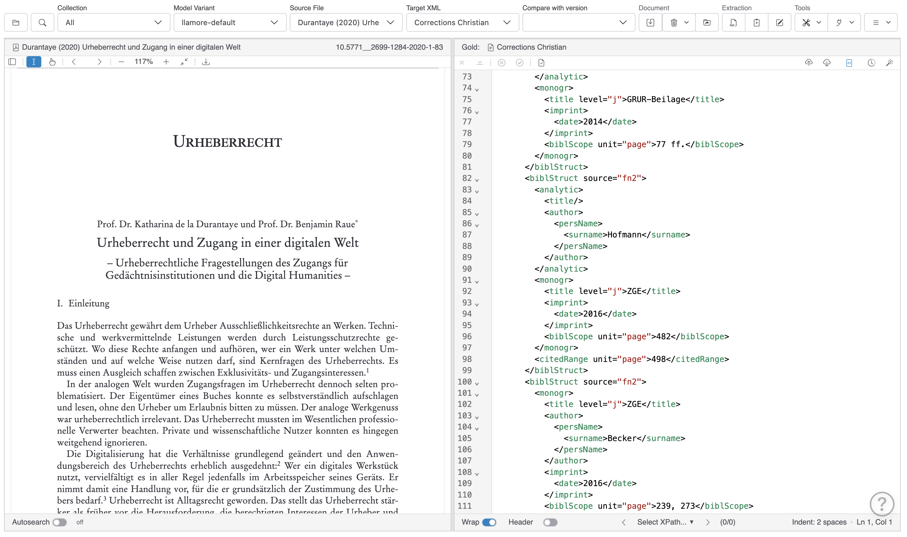

# Interface Overview

The PDF-TEI Editor features a two-panel layout designed for efficient comparison and editing of PDF documents and their corresponding TEI markup.

## Main Layout

### Left Panel: PDF Viewer

The left panel contains the PDF document viewer, which offers the following functionality shipped with the standard PDF.js viewer.

- **Header Bar**: Document title and document id 
- **Document Navigation**: Page controls, zoom, and search functionality
- **PDF Toolbar**: Standard PDF viewing tools including zoom, page navigation, and text selection
- **Page Display**: Shows the source PDF document with footnotes and bibliographic references

The header bar of the PDF viewer provides the following information:

- on the left, the PDF document title which is taken from document metadata. 
- on the right, the document id which is used to identify the PDF and all TEI annotations (regardless of variant) that belong to it.

Both values can be copied by single-click, in addition, administrators can change title and id by double-clicking.

In the status bar of the PDF viewer, you can toggle the "Autosearch" feature, which tries to automatically navigate to the position within the PDF that corresponds to the cursor position in the XML Editor. It works well on most documents; results can be less reliable when the PDF's underlying text extraction is poor (e.g. scanned pages or unusual layouts).

### Right Panel: XML Editor  

The right panel contains the CodeMirror-based XML editor and provides the following features:

- **Syntax Highlighting**: Color-coded TEI/XML markup for easy reading
- **Schema Validation**: Real-time validation against TEI schemas with error highlighting

It consists of the following components:

- **Header Bar**: Displays version title (left) and document information (locked status, saving indicator, etc.) on the right. The version title can be updated by double-clicking on it.
- **Toolbar**: Editing controls on the left (diff navigation, wrapping, TEI header, validation, undo/redo). On the right, three sections: document history and review, import and export (<sl-icon name="cloud-upload"></sl-icon> upload, <sl-icon name="cloud-download"></sl-icon> download), and the buttons that plugins add, such as the <sl-icon name="magic"></sl-icon> TEI Wizard and the XSL transformation viewer. See [Toolbar Buttons](editing-workflow.md#toolbar-buttons).
- **Status Bar**: Shows the XPath navigation, review and comment counters, indentation settings and cursor position. The editor theme picker (<sl-icon name="palette"></sl-icon>) sits at the far right. When the panel is narrow, the cursor position is hidden first.

## Top Toolbar

The toolbar is organized into logical sections. The application itself provides the following; plugins can add further buttons and menu entries.

### File Selection

- <sl-icon name="folder2"></sl-icon> **Collection & Files**: Opens the file selection drawer
- **Collection**, **Model Variant**, **Source File**, **Target XML**: Select the document and the XML version to edit
- **Compare with version**: Select a version for side-by-side comparison

### Document

- <sl-icon name="save"></sl-icon> **Save revision**: Record the current state in the revision history, optionally as a new personal copy
- <sl-icon name="trash3"></sl-icon> **Delete**: Delete the current version, all versions, or the PDF and all XML

### Extraction

- <sl-icon name="filetype-pdf"></sl-icon> **Extract New**: Upload a new PDF and extract data
- <sl-icon name="clipboard2-plus"></sl-icon> **Extract Current**: Extract from the current PDF into a new XML version

### Tools and User Menu

- <sl-icon name="tools"></sl-icon> **Tools**: Menu with further tools; plugins add their entries here
- <sl-icon name="person"></sl-icon> **User menu**: Account settings and logout

### Added by Plugins

Depending on the installed plugins, the toolbar contains further buttons, for example the login dashboard, document search, or <sl-icon name="arrow-repeat"></sl-icon> synchronization with a WebDAV repository (WebDAV sync plugin). Uploading and downloading XML and running the TEI Wizard are done in the XML editor toolbar.

## Navigation Features

### XPath Navigation

The floating panel allows navigation using XPath expressions:

- **Default**: `//tei:biblStruct` to navigate between bibliographic entries
- **Custom XPath**: Select "Custom XPath" to enter your own expression
- **Navigation Buttons**: Use << and >> to move between matching nodes
