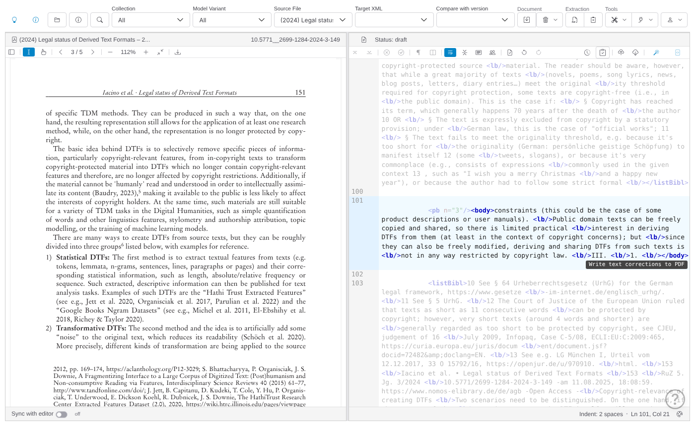
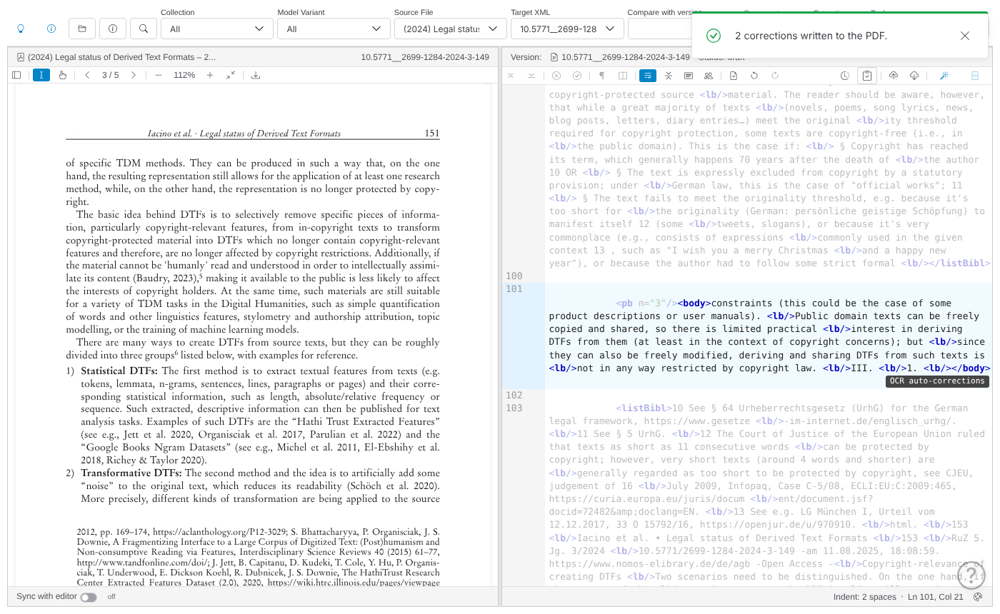

# Editing with a Language Model

A language model can help you annotate a document and correct the errors of text recognition (OCR). This page describes how to work through a document unit by unit with it: you annotate a unit by hand or let the model review its annotations, correct the OCR errors you spot with the model's help, write the corrections into the PDF, and go on with the next unit.

You need:

- a default model, which you set under **Tools > Inference > Default Model** (see [Choosing a Language Model](language-models.md)),
- for the annotation review: the [LLM Reviewer](https://github.com/mpilhlt/pte-plugins/blob/main/plugins/annotation-review/README.md) plugin and a document that links to machine-readable annotation rules,
- for the OCR correction: a document with a page layout, such as a GROBID segmentation document (`grobid.training.segmentation`),
- for writing corrections into the PDF: the reviewer role, and a version of the document that you can edit.

## 1. Go to the first unit

Choose the unit to work in with the node navigation in the statusbar of the XML editor (see [XPath Navigation](editing-workflow.md#xpath-navigation)). In a segmentation document, choose **Page (`<pb>`)** to go from page to page. In [focus mode](editing-workflow.md#focus-mode), the unit is in the centre, the rest of the document is dimmed, and the buttons of the language model are shown in the bottom right corner of the unit. The PDF viewer shows the page of the unit when **Sync with editor** is on.

## 2. Annotate the unit

Annotate the unit by hand first, or click **Annotation auto-review** right away: the model checks the annotations of the unit against the annotation rules. Its suggestions appear in the **Diagnostics** drawer and as highlights in the editor. Check each one against the PDF and the annotation guide, then take it over with **Propose fix** or **Apply fix**, or dismiss it (see [Diagnostics drawer](editing-workflow.md#diagnostics-drawer)). The review of the focused unit starts without asking; **Tools > Review document annotations** reviews the whole document and asks for confirmation first.

## 3. Correct the OCR errors of the unit

If you spot errors of the text recognition, such as misread letters or garbled footnote numbers, click **OCR auto-corrections**. The model looks for OCR errors on the pages of the unit, and its suggestions appear in the Diagnostics drawer. The review starts right away; only **Tools > OCR > Find OCR errors (LLM)**, which reviews the whole document, asks for confirmation. Each suggestion shows the old and the new text and why the model thinks it is an error. Accept the suggestions you agree with and dismiss the others. You can also correct words by hand.

*The model found two OCR errors on the page. The button of the page now writes the corrections into the PDF.*

Each suggestion you take over is recorded in the revision history of the document, under your name and with the name of the model that suggested it.

## 4. Write the corrections into the PDF

Once the model has found errors in the unit, its button changes from **OCR auto-corrections** to **Write text corrections to PDF**. The corrections are first only in the TEI document. Click the button to write the corrections on the pages of the unit into the text layer of the PDF, so that Autosearch, the text selection of the PDF viewer and new extractions use the corrected text.

*The suggestions have been applied to the TEI document. The button writes them into the PDF.*

Only the pages of the unit are compared with the text layer, so this takes a few seconds. The document is saved first. If all corrections can be written, they are written without a dialog; if some differences cannot be written, a dialog lists them and asks whether to skip them (see [Writing text corrections to the PDF](extraction-workflow.md#writing-text-corrections-to-the-pdf)). The corrections are written into a copy of the PDF. No new version of the document is created: the version you are editing is attached to the corrected PDF, which the PDF viewer then shows at the same page, and an entry in its revision history records under your name how many corrections were written on which pages. Other versions of the document keep their PDF.

*The corrections are in the PDF. The page has the "OCR auto-corrections" button again.*

Afterwards, the unit has the **OCR auto-corrections** button again, so you can run the OCR correction once more. If there is nothing to write, for example because you dismissed all suggestions, a message says so and the button changes back as well.

## 5. Go on with the next unit

Go to the next unit with **›** or the **↓** arrow key and repeat steps 2 to 4. Save a revision from time to time, for example at the end of a working day (see [Saving a Revision](editing-workflow.md#saving-a-revision)).

## When the whole document is done

Writing the corrections page by page does not update the data that the extraction service keeps for the PDF, such as GROBID's feature file of the PDF, since that takes a minute or longer for the whole PDF; the page layout of the document stays correct, since the corrections do not move the words. When you have finished the document, choose **Tools > OCR > Write text corrections to PDF**. It writes the corrections that are left, updates the document for the corrected PDF, and creates a new version labelled "Corrected text layer", also when all corrections were already written page by page. The dialog asks for confirmation and says what will be done.
