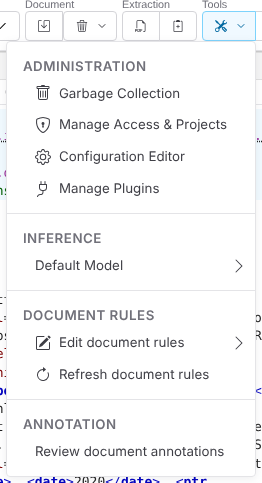

# Plugins

Much of what the PDF-TEI Editor can do is provided by plugins: extractors such as GROBID, LLM providers, the LLM Reviewer, synchronization with WebDAV or the local file system, overviews of the annotation progress and many of the views in the **Tools** menu. Which plugins are available depends on your installation, so the menus and buttons you see may differ from the screenshots in this manual.

## Where plugins appear

Plugins add their functions to the existing parts of the interface:

- entries in the <sl-icon name="tools"></sl-icon> **Tools** menu, grouped in sections,
- buttons in the toolbar (see [Added by Plugins](interface-overview.md#added-by-plugins)) and in the XML editor toolbar,
- extractors and their options in the extraction dialog (see [Extraction Workflow](extraction-workflow.md)),
- entries in the context menu of the XML editor, such as **Bookmark…** and **Comment…** (see [Editing Workflow](editing-workflow.md)),
- models under **Tools** > **Inference** > **Default Model**, registered by the LLM provider plugins.

*The Tools menu of an administrator. "Review document annotations" under Annotation is added by the LLM Reviewer plugin.*

Some plugins are only shown to users with a particular role, and some become available only after an administrator has configured them, for example with the URL of a server or an API key.

## Plugin documentation

Most plugins are maintained in the [pte-plugins](https://github.com/mpilhlt/pte-plugins) repository. Its [plugin overview](https://mpilhlt.github.io/pte-plugins/) lists all of them with a short description, the current version, the editor versions they work with and links to their documentation (README), source code and releases. Plugins that ship further documentation, such as the schema and annotation guidelines of the archival edition plugin, publish it there as well.

The plugins that ship with the application, such as the dashboard, the review queue, document search and the TEI Wizard, are described on the pages of this manual that cover the respective workflow.

## Which plugins are installed

Administrators see the installed plugins, their status and a **README** button linking to each plugin's documentation in the [Plugin Manager](plugin-manager.md) (**Tools** > **Administration** > **Manage Plugins**). There they can switch plugins on or off and, if the operator allows it, install plugins from the plugin overview. If a function described in a plugin's documentation is missing in your installation, ask your administrator whether the plugin is installed and enabled.
