# Review Workflow: From Extraction to Approval

This page describes a recommended way to take a document from the first machine extraction to an approved annotation. It assigns clear responsibilities to annotators and reviewers and shows how the work is handed over between them. [Document Editing](editing-workflow.md) describes the editor features in general; this page shows how to combine them.

The workflow is opinionated: it fixes one way of working, so that everybody knows what to do next. It does not depend on a particular schema or variant. The screenshots show GROBID reference data, but the steps are the same for any other kind of document.

**Who should read what:**

| Section | Annotators | Reviewers |
| --- | --- | --- |
| [Overview](#overview) | ✓ | ✓ |
| [1. Extracting and preparing the documents](#1-extracting-and-preparing-the-documents) | | ✓ |
| [2. Handing the documents to the annotators](#2-handing-the-documents-to-the-annotators) | | ✓ |
| [3. Annotating and submitting for review](#3-annotating-and-submitting-for-review) | ✓ | |
| [4. Reviewing](#4-reviewing) | read it once | ✓ |
| [5. Correcting](#5-correcting) | ✓ | |
| [6. Checking the corrections](#6-checking-the-corrections) | | ✓ |
| [7. Approving](#7-approving) | | ✓ |
| [Rules of thumb](#rules-of-thumb) | ✓ | ✓ |

**Not covered here:**

- How annotators organise their work among themselves before they submit a document for review: for example, whether two annotators annotate the same document in parallel or one after the other. This is left to each project.
- What happens after a document is approved (gold standard, training, export).
- Setting up the application. Administrators find the prerequisites in [For administrators](#for-administrators) at the end of this page.

## Overview

The workflow has three principles:

1. **Everybody works in their own version.** An annotator makes a personal copy of the extraction and is the only one who edits it. Reviewers do not change the annotator's text; they give feedback with review marks and comments.
2. **The status says whose turn it is.** The status of the latest revision tells everybody what is going on: *extraction* means the document is ready to be annotated, *in-review* means the reviewers have to act, *approved* means the work is done.
3. **The application carries the hand-overs.** Saving a revision with the status *in-review* notifies the reviewers. Marking a unit *not OK* notifies the annotator. A correction appears in the reviewer's diagnostics. You do not need e-mail or a chat to coordinate the review.

| Step | Who | Status | Hand-over |
| --- | --- | --- | --- |
| 1. Extract and prepare | Reviewer | *extraction* | |
| 2. Hand over | Reviewer | *extraction* | Document link or shared link to the Annotation Progress view |
| 3. Annotate, submit | Annotator | *draft* … *in-review* | Message to the reviewers, entry in the review queue of the dashboard |
| 4. Review | Reviewer | *in-review* | Message to the annotator for each not-OK mark, live update in the annotator's editor |
| 5. Correct | Annotator | *in-review* | "Changed after a not-OK review" in the reviewer's diagnostics |
| 6. Check corrections | Reviewer | *in-review* | Steps 5 and 6 repeat until all units are OK |
| 7. Approve | Reviewer | *approved* | The document counts as done in the Annotation Progress view and on the dashboard |

The workflow relies on three optional components of the application, which your administrator has to set up:

- [owner-based access control](access-control.md#owner-based-mode): only the owner of a version can change it,
- the **Annotation Progress** plugin: an overview of the documents of a collection and their status,
- [unit review](unit-review.md), [unit comments](unit-comments.md) and [messages](messages.md), together with the dashboard and its review queue.

## 1. Extracting and preparing the documents

*Reviewer*

Upload the PDFs and extract them into the collection, either one by one in the editor (see [Extraction Workflow](extraction-workflow.md)) or with a batch script (see [Batch Processing](batch-processing.md)). Each extraction is saved with the status *extraction* and is owned by the user who ran it.

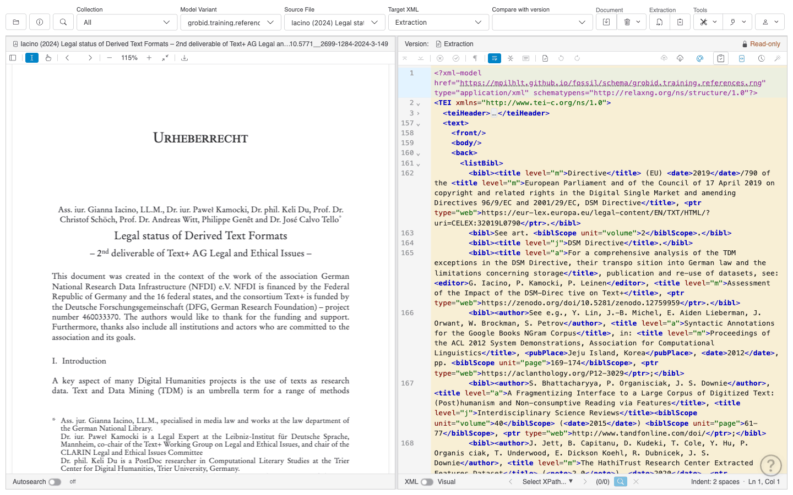

Before you hand the documents over, you can clean up the extraction, for example with the **TEI Wizard** (wand icon in the editor toolbar): *Pretty Print XML* puts each unit on its own line, which makes the review easier, and *Fix Common Extraction Issues* corrects errors that extractors typically make. Do this now and not later: every change that you make after the annotators have made their copies has to be made in each copy.

Keep the clean-up mechanical. Anything that requires a decision about the content is the annotators' work.

## 2. Handing the documents to the annotators

*Reviewer*

Tell the annotators that they can start. There are two ways:

**a) Assign documents to individual annotators.** Open the document and copy the URL from the browser's address bar. The link opens the same PDF and the same version once the recipient has logged in. Send each annotator the links of the documents they should work on. Use this when you want to control who works on what.

**b) Let the annotators choose.** Open the **Annotation Progress** view of the collection: choose the collection and the variant, then open *Show Annotation Progress* in the backend plugins menu of the **Tools** group, or click the variant's progress ring in the *Annotation progress* box of the dashboard. **Share link** copies a link that opens this view for the same collection and variant. Send it to the annotators; they pick the documents that nobody has taken yet, that is, those that only have the extraction.

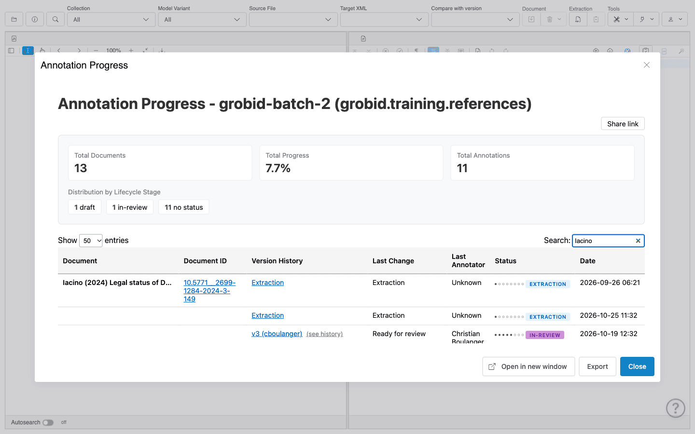

With b), agree on how annotators claim a document. The simplest rule is: whoever makes the first copy (step 3) owns the document. The new version shows up in the Annotation Progress view with the annotator's name, so the others can see that it is taken.

## 3. Annotating and submitting for review

*Annotator*

### Make your own copy

Open the document from the link you received, or from the Annotation Progress view. The extraction belongs to the reviewer who ran it, so it is read-only for you (lock icon and *Read-only* in the top right corner of the editor).

Click **Save revision** (floppy disk icon). *Save to a new personal version* is already checked because you do not own the document. Leave the label as suggested (it contains your user name), enter a short description and click **Save Revision**.

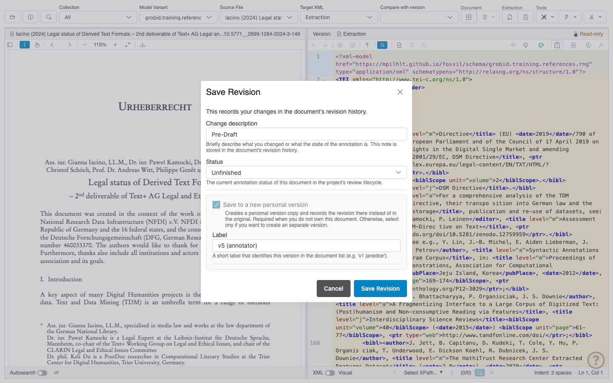

You are now editing your own copy. The extraction is superseded by your copy and becomes read-only for everyone.

### Annotate

Work in your copy as described in [Document Editing](editing-workflow.md). Your changes are saved automatically. Use **Save revision** only for milestones that you want to see in the revision history, for example at the end of a working day, with status *draft*. Do not make a new personal version for each session: one annotator, one version.

### Submit for review

When you are done with the whole document, click **Save revision** once more, describe the state of the document (for example "Annotation complete, ready for review"), set **Status** to *In-review* and click **Save Revision**.

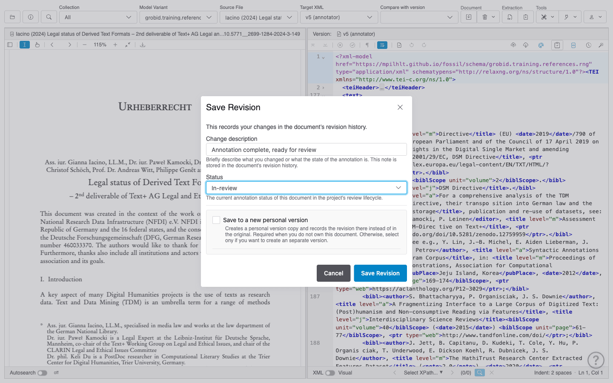

This is the hand-over to the reviewers: each reviewer receives a message, and the document appears in the review queue of their dashboard. Set *in-review* only when you have really finished; the reviewers will start reviewing right away.

## 4. Reviewing

*Reviewer*

### Find the documents waiting for review

The dashboard opens after login (reopen it with the info button in the toolbar). Its **Waiting for review** box lists the documents whose latest version has the status *in-review*; click the label of a version to open it.

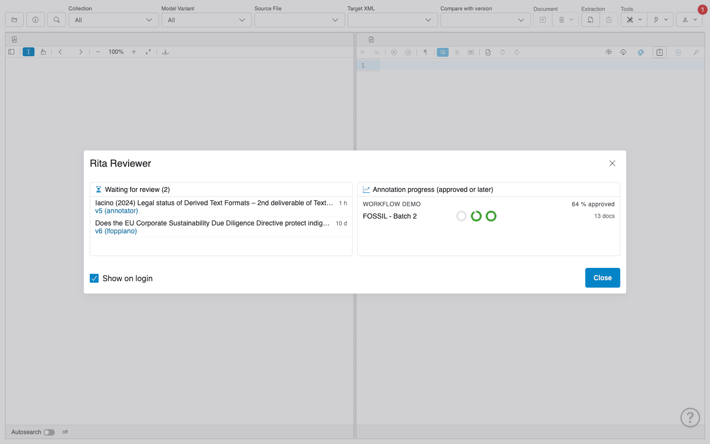

You also receive a message for each submitted document. The red badge on the user menu shows the number of unread messages; open them with **Messages** in the user menu. Clicking the message opens the document with review mode on.

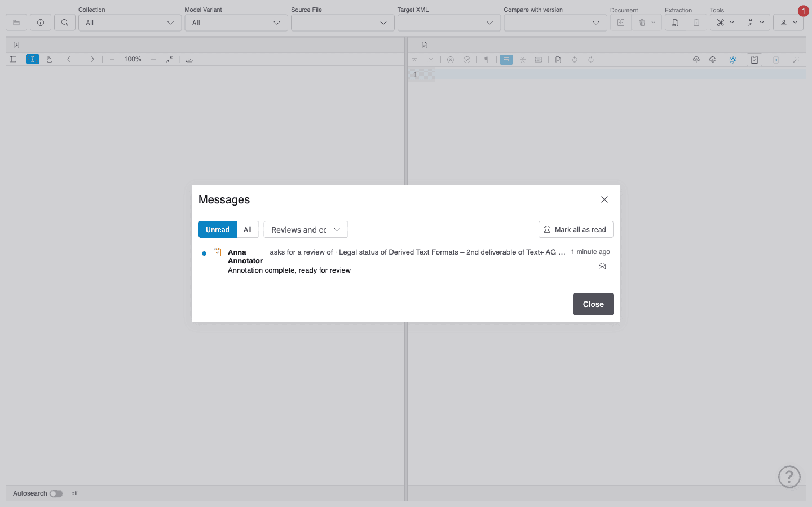

### Review unit by unit

The annotator's version is read-only for you. You cannot change the text, and you should not want to: your job is to say what is wrong, the annotator's job is to fix it. You can, however, set review marks and write comments; the server saves them into the annotator's version.

Review mode is switched on with the **Review** button (clipboard icon). Then go through the units, for example the `<bibl>` elements of a reference list (see [Unit Review](unit-review.md) for all shortcuts):

- `Ctrl+Enter` (`Cmd+Enter` on macOS) marks the unit at the cursor as OK and moves to the next unit. To mark a range of units as OK, select them and press `Ctrl+Enter`.
- `Ctrl+Shift+Enter` marks it as not OK and asks for a comment. Write a comment that the annotator can act on: what is wrong and what it should be, if possible with a reference to the annotation guidelines.

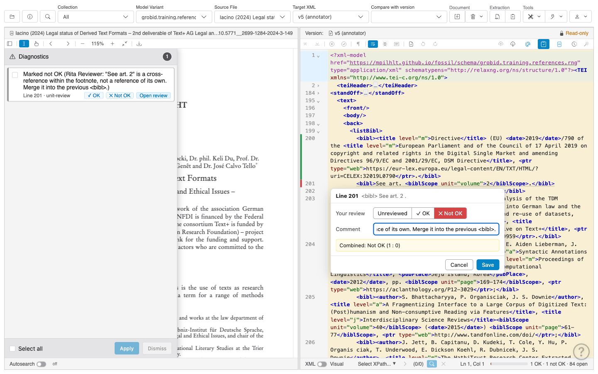

The strip left of the line numbers shows the result: green for OK, red for not OK. The progress meter in the status bar counts the units that are OK, not OK and still open.

For questions and remarks that are not a verdict on a unit, use a [unit comment](unit-comments.md) (`Ctrl+Shift+M`, or **Comment…** in the context menu). A comment only notifies the users mentioned in it, so mention the annotator with `@` (for example `@annotator`) if they should react to it.

You do not need to review the whole document in one go. Your marks are saved as you set them.

## 5. Correcting

*Annotator*

You learn about the reviewer's feedback in two ways:

- **Messages**: each unit marked as not OK by a reviewer and each comment in which you are mentioned arrives in your inbox. Clicking the message opens your version at the unit, with the review popover open.
- **Live in the editor**: if you have your version open, the reviewer's marks and comments appear immediately, without reloading.

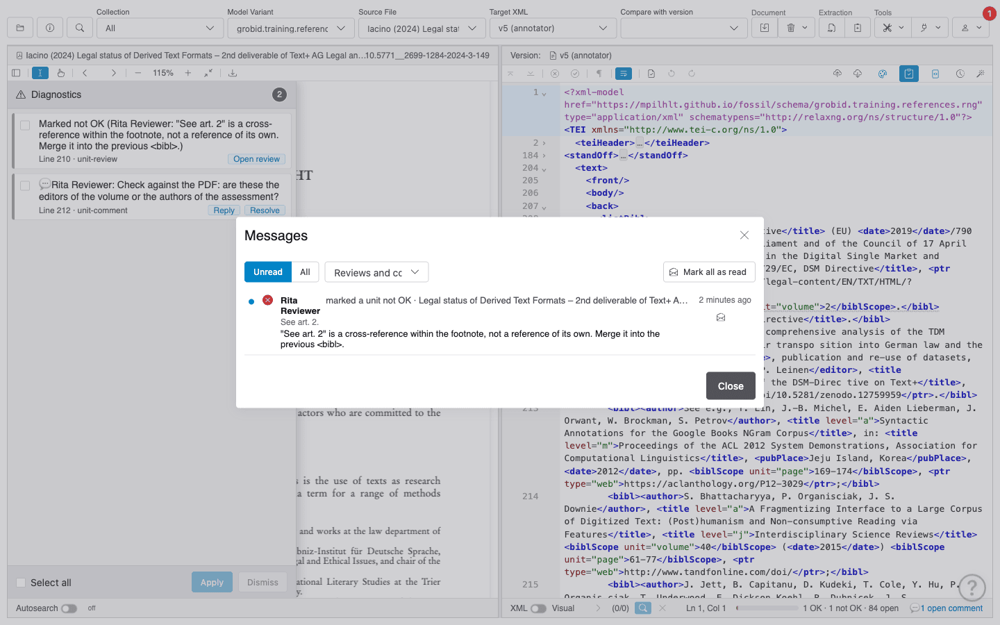

The not-OK units and open comments are listed in the **Diagnostics** drawer on the left. Click an entry to jump to its unit.

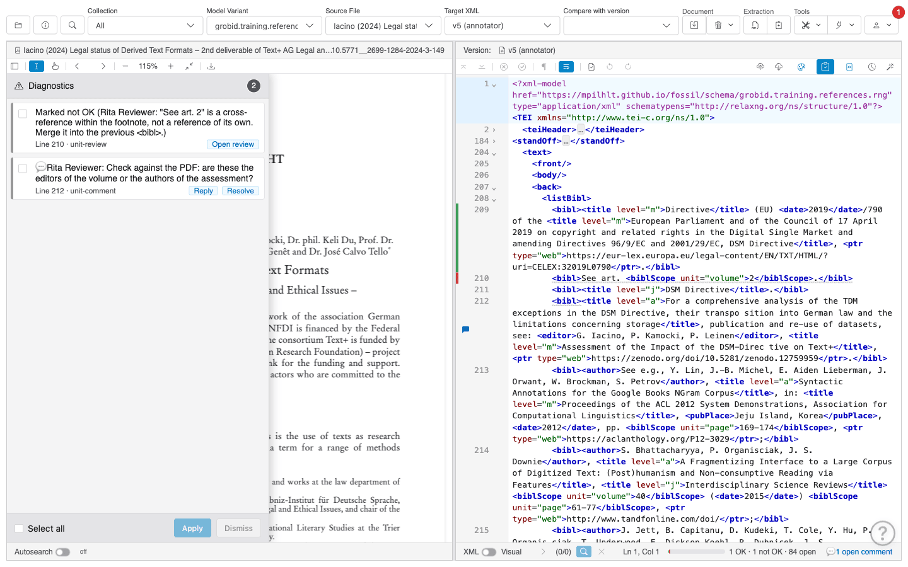

Correct the unit in your version, as you annotated it in step 3. You do not need to save a revision or change the status: the document stays *in-review* until the reviewer approves it. Your edit is saved automatically, and the unit is shown with grey dashes until the reviewer has looked at it again. In the diagnostics drawer, it is now listed as *Changed after a not-OK review … please check again*.

Answer the reviewer's comments with **Reply**, either in the diagnostics drawer or in the comment popover. The reviewer is notified of the reply. If you disagree with a not-OK mark, do not just leave the unit as it is: say why in a comment that mentions the reviewer.

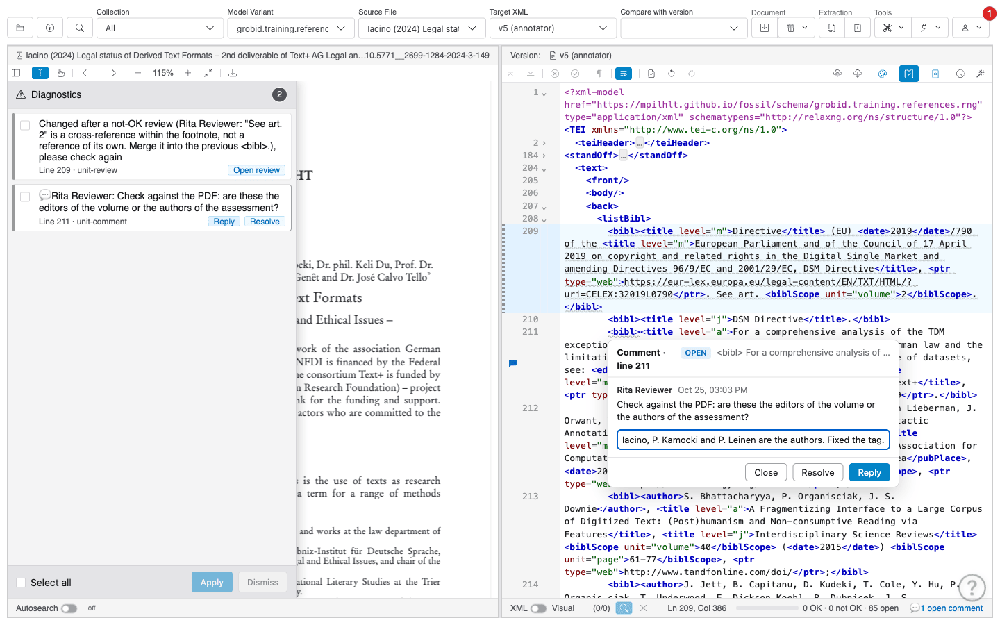

Do not make a new version to answer the feedback, and do not mark units as OK yourself: the review takes place in the version that was submitted.

## 6. Checking the corrections

*Reviewer*

If you have the annotator's version open, it is reloaded a few seconds after the annotator saved a change. Otherwise, open it again from the dashboard or from the annotator's reply in your inbox.

Corrected units are listed in the **Diagnostics** drawer as *Changed after a not-OK review*. For each of them, decide again:

- **✓ OK** if the correction fixes the problem,
- **✕ Not OK** if it does not, with a new comment. The annotator is notified again, and the round of steps 5 and 6 repeats.

Resolve the comment threads that have been dealt with (**Resolve**). `Shift+F7` jumps to the next unit that is not OK or needs to be checked again.

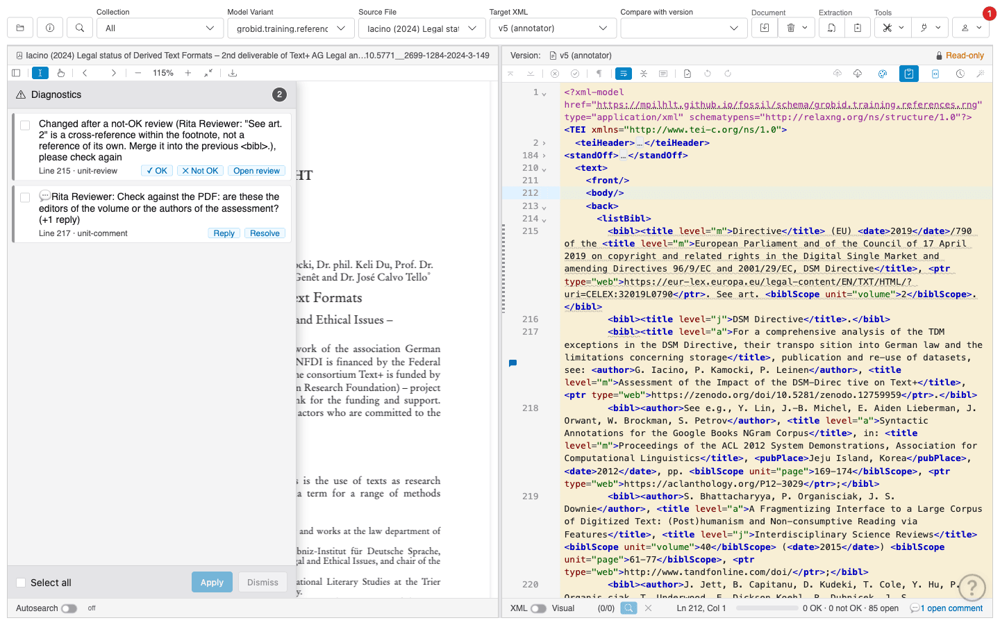

## 7. Approving

*Reviewer*

When all units are OK (the progress meter shows *0 not OK · 0 open*, and the editor tells you *All units are reviewed*), approve the document: click **Save revision**, describe the result (for example "Review complete, approved"), set **Status** to *Approved* and click **Save Revision**.

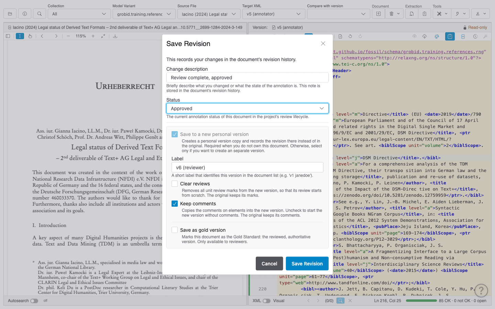

Because you do not own the annotator's version, *Save to a new personal version* is checked and cannot be unchecked: the approved state is recorded in a new version in your name, which supersedes the annotator's version. The annotator's version, with all review marks and comments, stays in the version history and is read-only from now on. Keep *Keep comments* checked so that the discussion stays with the document; whether you check *Clear reviews* depends on what your project does after approval.

If units are still not OK, disputed or not reviewed, the editor asks you to confirm before it saves the status *approved*. Do not override this unless you know why.

The approved version replaces the annotator's version in the review queue (which then no longer lists the document) and counts as done in the Annotation Progress view and in the progress rings of the dashboard. Its history shows the path of the document: extraction, annotator's version, approved version.

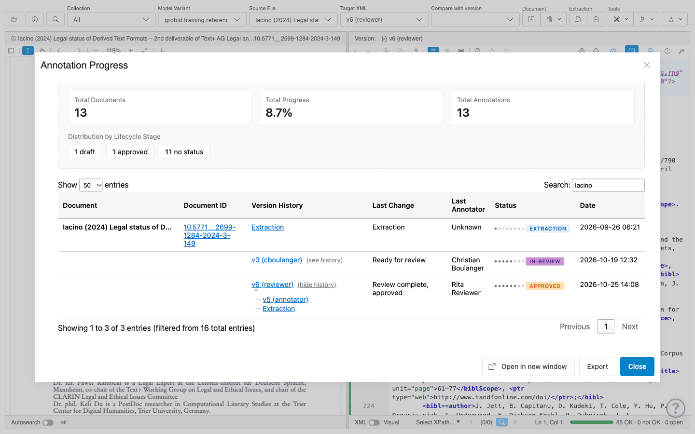

## Rules of thumb

**For annotators**

- One document, one personal version. Make it once, at the start, and do all your work in it, including the corrections after the review.
- Set *in-review* only when you have finished the whole document.
- Do not leave a not-OK mark unanswered: either correct the unit or explain in a comment why it is correct.
- Check your inbox when you start working. The badge on the user menu tells you if there is something new.

**For reviewers**

- Never edit an annotator's version. Give feedback with marks and comments, so that the annotator learns from it and the correction is documented.
- One not-OK mark per problem, with a comment that says what to change. "Wrong" is not a comment.
- Mention the annotator in comments that need an answer; comments without a mention notify nobody.
- Approve only when the progress meter shows no not-OK and no open units.
- If several reviewers review the same document, agree on how marks are combined (see [Combining the marks of several reviewers](unit-review.md#combining-the-marks-of-several-reviewers)).

## For administrators

The workflow requires the following configuration:

| Setting | Value | Why |
| --- | --- | --- |
| `access-control.mode` | `owner-based` | Only the owner can edit a version; everybody else reviews and comments (see [Access Control](access-control.md#owner-based-mode)). |
| `annotation.lifecycle.role.annotator` | must contain `in-review` | Annotators submit their versions for review. The default configuration does not allow annotators to set *in-review*. |
| `annotation.lifecycle.role.reviewer` | must contain `approved` | Reviewers approve the documents (included by default). |
| `plugin.review-queue.statuses` | `["in-review"]` (default) | Statuses listed in the review queue of the dashboard. |
| `plugin.annotation-progress.dashboard-threshold` | `approved` (default) | Status from which a document counts as done on the dashboard. |

Plugins: the *dashboard* and *review-queue* plugins ship with the application; the *annotation-progress* plugin is installed from the [pte-plugins](https://github.com/mpilhlt/pte-plugins) repository (see [Plugin Manager](plugin-manager.md)).

Users: annotators need the roles `user` and `annotator`, reviewers `user`, `annotator` and `reviewer`. Roles do not include each other: without the `user` role, the Annotation Progress view is not available. Annotators and reviewers must be members of a project that contains the collection (see [Access Control](access-control.md)).
